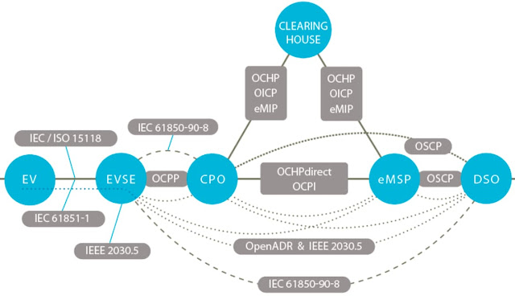

# Awesome Electric Vehicle 

A carefully curated list of specifications, tools, and resources for electric vehicle (EV) charging protocols — a central point of information for developers and enthusiasts working in the e-mobility space.

## Contents

<!-- BEGIN GENERATED TOC -->
- [Specifications](#specifications)
  - [OCPP (Open Charge Point Protocol)](#ocpp-open-charge-point-protocol)
  - [ISO 15118](#iso-15118)
  - [OCPI (Open Charge Point Interface)](#ocpi-open-charge-point-interface)
  - [OICP (Open InterCharge Protocol)](#oicp-open-intercharge-protocol)
  - [eMIP (eMobility Protocol Inter-Operation)](#emip-emobility-protocol-inter-operation)
  - [eMI³ (eMobility ICT Interoperability)](#emi-emobility-ict-interoperability)
  - [NeMo (Hyper-Network for electroMobility)](#nemo-hyper-network-for-electromobility)
  - [Eichrecht](#eichrecht)
  - [OIOI (discontinued)](#oioi-discontinued)
- [Tools and Resources](#tools-and-resources)
  - [OCPP](#ocpp)
  - [OCPI](#ocpi)
  - [iso15118](#iso15118)
  - [Eichrecht](#eichrecht-1)
  - [Other](#other-1)
  - [Uncategorized](#uncategorized)
<!-- END GENERATED TOC -->

## Specifications

### OCPP (Open Charge Point Protocol)

The **Open Charge Point Protocol (OCPP)** is a communication protocol between electric vehicle charging stations and a central management system.

- [Wikipedia](https://en.wikipedia.org/wiki/Open_Charge_Point_Protocol)
- [Open Charge Aliance](https://www.openchargealliance.org/)
- Specifications
  - [2.1](https://github.com/juherr/awesome-ev-charging/tree/main/ocpp/OCPP-2.1) (2025-01)
  - [2.0.1](https://github.com/juherr/awesome-ev-charging/tree/main/ocpp/OCPP-2.0.1) (2020-04)
  - [2.0 (deprecated)](https://github.com/juherr/awesome-ev-charging/tree/main/ocpp/OCPP-2.0) (2018)
  - [1.6](https://github.com/juherr/awesome-ev-charging/tree/main/ocpp/OCPP-1.6-Documentation_2019_12) (2015)
  - [1.6 - Security Whitepaper Ed3](https://github.com/juherr/awesome-ev-charging/tree/main/ocpp/Whitepapers/OCPP-1.6-security-whitepaper-edition-3-2)
  - [1.x - Multiple Connectors per EVSE](https://github.com/juherr/awesome-ev-charging/blob/main/ocpp/Whitepapers/ocpp_1_x_multiple_connectors_per_evse.pdf)
  - [1.5 (deprecated)](https://github.com/juherr/awesome-ev-charging/tree/main/ocpp/OCPP-1.5) (2012)
  - [1.2 (deprecated)](https://github.com/juherr/awesome-ev-charging/tree/main/ocpp/OCPP-1.2) (2010)
- [Configuration Keys (1.6)](https://github.com/juherr/awesome-ev-charging/blob/main/ocpp/OCPP-1.6-configuration-keys.md) - Reference table of OCPP 1.6 configuration keys.

### ISO 15118

**ISO 15118** is an international standard for communication between electric vehicles and the charging station.

- [Wikipedia](https://en.wikipedia.org/wiki/ISO_15118)
- [iso.org](https://www.iso.org/search.html?PROD_isoorg_en%5Bquery%5D=15118&PROD_isoorg_en%5Bmenu%5D%5Bfacet%5D=standard)

### OCPI (Open Charge Point Interface)

The **Open Charge Point Interface (OCPI)** is a protocol for roaming between charging station networks.

- [EVRoaming Fundation](https://evroaming.org/)
- [Specifications on GitHub](https://github.com/ocpi/ocpi)
  - [2.3.0-d2](https://github.com/ocpi/ocpi/releases/download/v2.3.0-ed2/OCPI-2.3.0-ed2.pdf) (2026-06)
  - [2.3.0](https://evroaming.org/wp-content/uploads/2025/02/OCPI-2.3.0.pdf) (2025-02)
  - [2.2.1](https://github.com/ocpi/ocpi/releases/download/2.2.1/OCPI-2.2.1.pdf) (2021-10)
  - [2.2.0-d2](https://github.com/ocpi/ocpi/releases/download/2.2-d2/OCPI-2.2-d2.pdf) - Deprecated, use 2.2.1 instead (2020-06)
  - [2.2.0](https://github.com/ocpi/ocpi/releases/download/2.2/OCPI-2.2.pdf) - Deprecated, use 2.2.0-d2 instead (2019-09)
  - [2.1.1-d2](https://github.com/ocpi/ocpi/releases/download/2.1.1-d2/OCPI_2.1.1-d2.pdf) (2019-06)
  - [2.1.1](https://github.com/ocpi/ocpi/releases/download/2.1.1/OCPI_2.1.1.pdf) - Deprecated, use 2.1.1-d2 instead (2017-06)
  - 2.1.0 - Deprecated, contains some bugs, use 2.1.1 instead (2016-04)
  - [2.0](https://github.com/ocpi/ocpi/files/135934/OCPI_2.0-d2.pdf) (2016-02)
- [ocpi.github.io](https://ocpi.github.io/) - OCPI feature-development hub: proposals and processes for upcoming spec versions.
- Official OpenAPI/Swagger definitions and migration guides (rendered from the [openapi-specification](#api-specification) project).
  - [2.3.0 Swagger UI](https://ocpi.github.io/openapi-specification/ocpi/2.3.0/)
  - [2.2.1 → 2.3.0 migration guide](https://ocpi.github.io/openapi-specification/migrations/2.2.1-2.3.0/migration-guide.html)
  - [2.2.1 Swagger UI](https://ocpi.github.io/openapi-specification/ocpi/2.2.1/)
  
- [ocpi.fyi](https://ocpi.fyi/) - A browsable rendering of the OCPI specification with an API reference and version comparison. 🏅
  - [2.3.0 Swagger](https://ocpi.fyi/api/2.3.0/swagger/) (unofficial)
  - [2.2.1 Swagger](https://ocpi.fyi/api/2.2.1/swagger/) (unofficial)
  - [2.1.1 Swagger](https://ocpi.fyi/api/2.1.1/swagger/) (unofficial)

#### Modules

OCPI 2.3.0 is published as a [core specification](https://github.com/ocpi/ocpi/tree/2.3.0/release/core) plus optional modules packaged separately.

Core functional modules:

| Module                 | Specification per version                                           |
| ---------------------- | ------------------------------------------------------------------- |
| Locations              | [2.1.1][ocpi-loc-211], [2.2.1][ocpi-loc-221], [2.3.0][ocpi-loc-230] |
| Sessions               | [2.1.1][ocpi-ses-211], [2.2.1][ocpi-ses-221], [2.3.0][ocpi-ses-230] |
| CDRs                   | [2.1.1][ocpi-cdr-211], [2.2.1][ocpi-cdr-221], [2.3.0][ocpi-cdr-230] |
| Tariffs                | [2.1.1][ocpi-tar-211], [2.2.1][ocpi-tar-221], [2.3.0][ocpi-tar-230] |
| Tokens                 | [2.1.1][ocpi-tok-211], [2.2.1][ocpi-tok-221], [2.3.0][ocpi-tok-230] |
| Commands               | [2.1.1][ocpi-cmd-211], [2.2.1][ocpi-cmd-221], [2.3.0][ocpi-cmd-230] |
| Charging Profiles      | [2.2.1][ocpi-cp-221], [2.3.0][ocpi-cp-230]                          |
| Hub Client Info        | [2.2.1][ocpi-hci-221], [2.3.0][ocpi-hci-230]                        |
| Invoice Reconciliation | [2.3.0 (ed2)][ocpi-ir-230]                                          |

Additional modules (packaged separately). Payments and Bookings are optional, evolve independently of the core, and are published as standalone PDFs bundling a core edition with the module. They are independent from each other and from Invoice Reconciliation — an implementation may support any of them on its own.

- Payments (2.3.0)
  - [ed2](https://github.com/ocpi/ocpi/releases/download/v2.3.0-ed2-payments/OCPI-2.3.0-ed2-payments.pdf) (2026-06, core edition 2 + Payments)
  - [ed1](https://github.com/ocpi/ocpi/releases/download/v2.3.0-payments/OCPI-2.3.0-payments.pdf) (2026-06, core edition 1 + Payments)
- Booking (2.3.0) — exact version labels are still being settled; the OCPI editors deferred on this in [ocpi/ocpi#572](https://github.com/ocpi/ocpi/issues/572)
  - ed2 — not yet released
  - [ed1](https://github.com/ocpi/ocpi/releases/download/v2.3.0-bookings/OCPI-2.3.0-bookings.pdf) (2026-06, tag `v2.3.0-bookings`)
  - [1.1](https://evroaming.org/wp-content/uploads/2026/01/OCPI-2.3.0-booking-1.1.pdf) (2025-06, no GitHub tag)

Extensions (vendor / community):

| Extension                          | OCPI version | Source    | Date    |
| ---------------------------------- | ------------ | --------- | ------- |
| [Direct Payment][ext-dp]           | 2.2.1        | EVRoaming | 2024-03 |
| [e-PoI service][ext-epoi]          | 2.2.1        | Gireve    | 2025-10 |
| [Accessibility extension][ext-acc] | 2.3.0, 3.0   | EVRoaming | 2025-12 |
| [Autocharge][ext-ac]               | 2.3.0        | Community | —       |

[ocpi-loc-211]: https://github.com/ocpi/ocpi/blob/release-2.1.1-bugfixes/mod_locations.md
[ocpi-loc-221]: https://github.com/ocpi/ocpi/blob/release-2.2.1-bugfixes/mod_locations.asciidoc
[ocpi-loc-230]: https://github.com/ocpi/ocpi/blob/2.3.0/release/core/mod_locations.asciidoc
[ocpi-ses-211]: https://github.com/ocpi/ocpi/blob/release-2.1.1-bugfixes/mod_sessions.md
[ocpi-ses-221]: https://github.com/ocpi/ocpi/blob/release-2.2.1-bugfixes/mod_sessions.asciidoc
[ocpi-ses-230]: https://github.com/ocpi/ocpi/blob/2.3.0/release/core/mod_sessions.asciidoc
[ocpi-cdr-211]: https://github.com/ocpi/ocpi/blob/release-2.1.1-bugfixes/mod_cdrs.md
[ocpi-cdr-221]: https://github.com/ocpi/ocpi/blob/release-2.2.1-bugfixes/mod_cdrs.asciidoc
[ocpi-cdr-230]: https://github.com/ocpi/ocpi/blob/2.3.0/release/core/mod_cdrs.asciidoc
[ocpi-tar-211]: https://github.com/ocpi/ocpi/blob/release-2.1.1-bugfixes/mod_tariffs.md
[ocpi-tar-221]: https://github.com/ocpi/ocpi/blob/release-2.2.1-bugfixes/mod_tariffs.asciidoc
[ocpi-tar-230]: https://github.com/ocpi/ocpi/blob/2.3.0/release/core/mod_tariffs.asciidoc
[ocpi-tok-211]: https://github.com/ocpi/ocpi/blob/release-2.1.1-bugfixes/mod_tokens.md
[ocpi-tok-221]: https://github.com/ocpi/ocpi/blob/release-2.2.1-bugfixes/mod_tokens.asciidoc
[ocpi-tok-230]: https://github.com/ocpi/ocpi/blob/2.3.0/release/core/mod_tokens.asciidoc
[ocpi-cmd-211]: https://github.com/ocpi/ocpi/blob/release-2.1.1-bugfixes/mod_commands.md
[ocpi-cmd-221]: https://github.com/ocpi/ocpi/blob/release-2.2.1-bugfixes/mod_commands.asciidoc
[ocpi-cmd-230]: https://github.com/ocpi/ocpi/blob/2.3.0/release/core/mod_commands.asciidoc
[ocpi-cp-221]: https://github.com/ocpi/ocpi/blob/release-2.2.1-bugfixes/mod_charging_profiles.asciidoc
[ocpi-cp-230]: https://github.com/ocpi/ocpi/blob/2.3.0/release/core/mod_charging_profiles.asciidoc
[ocpi-hci-221]: https://github.com/ocpi/ocpi/blob/release-2.2.1-bugfixes/mod_hub_client_info.asciidoc
[ocpi-hci-230]: https://github.com/ocpi/ocpi/blob/2.3.0/release/core/mod_hub_client_info.asciidoc
[ocpi-ir-230]: https://github.com/ocpi/ocpi/blob/2.3.0/release/core/mod_invoice_reconciliation.asciidoc
[ext-dp]: https://evroaming.org/wp-content/uploads/2024/10/DirectPayment_2_2_1___EVRF_version.pdf
[ext-epoi]: https://www.gireve.com/wp-content/uploads/2025/10/Gireve_Tech_ePoI-OCPI-2.2.1_ImplementationGuide_V1.1-_en.pdf
[ext-acc]: https://evroaming.org/wp-content/uploads/2026/01/e_accessibility_extension-1.0.0.pdf
[ext-ac]: https://ocpi.fyi/ocpi/2.3.0/extensions/mod_autocharge_roaming.html

#### Roaming

Roaming relies on ID Registration Offices (IDRO) that assign and publish the operator (CPO) and provider (eMSP) identifiers exchanged over OCPI.

- [Identification Registration Repository](https://alternative-fuels-observatory.ec.europa.eu/markets-and-policy/policy-insights/identification-registration-repository) - The European reference, maintained by the European Alternative Fuels Observatory.
- [IDRO Directory](https://idro.juherr.dev/) - A global directory aggregating e-mobility identifiers from national and regional IDRO registries.

Roaming platforms (hubs) that interconnect CPOs and eMSPs, by founding year:

- 🇩🇪 [Hubject](https://hubject.com/) (2012)
- 🇫🇷 [Gireve](https://gireve.com/) (2013)
- 🇩🇪 [e-clearing.net](https://www.e-clearing.net/) (2014)
- 🇩🇪 [eNAPI](https://enapi.com/) (2024)
- 🇫🇷 [CO-OP ev](https://www.co-opev.com/) (2026)

### OICP (Open InterCharge Protocol)

The **Open InterCharge Protocol (OICP)** is another protocol for roaming, developed by Hubject.

- [Specifications on GitHub](https://github.com/hubject/oicp)
  - [2.3](https://github.com/hubject/oicp/tree/master/OICP-2.3) (2020-10)
  - 2.2: [CPO](https://github.com/hubject/oicp/releases/download/v2.2/OICP-CPO-2.2.pdf), [EMP](https://github.com/hubject/oicp/releases/download/v2.2/OICP-EMP-2.2.pdf) (2017-10)
  - 2.1: [CPO](https://github.com/hubject/oicp/releases/download/v2.1/OICP-CPO-2.1.pdf), [EMP](https://github.com/hubject/oicp/releases/download/v2.1/OICP-EMP-2.1.pdf) (2016-10, retired 2023-04-13)

### eMIP (eMobility Protocol Inter-Operation)

The **eMobility Protocol Inter-Operation (eMIP)** is a roaming protocol developed by Gireve.

- [Protocol description v1.0.17](https://www.gireve.com/wp-content/uploads/2025/02/Gireve_Tech_eMIP-V0.7.4_ProtocolDescription_1.0.17-en.pdf) (2025-02)
- [Implementation guide v1.0.7](https://www.gireve.com/wp-content/uploads/2022/09/Gireve_Tech_eMIP-V0.7.4_ImplementationGuide_1.0.7_en.pdf) (2022-09)

### eMI³ (eMobility ICT Interoperability)

**eMI³ (eMobility ICT Interoperability)** was a European initiative for e-mobility interoperability.

- [Website (archived)](https://web.archive.org/web/20230925033629/http://emi3group.com/)
- [Document index](https://github.com/juherr/awesome-ev-charging/blob/main/emi3/README.md) - Every PDF the website published, with a verified archived copy where one survives.
- [Statement on quality of e-mobility service](https://github.com/juherr/awesome-ev-charging/blob/main/emi3/eMI3-statement-on-QoS-2020-final.pdf) - Using publicly accessible charging infrastructures (2020-06).
- Specifications
  - eMi³ standard version V1.1 electric vehicle ICT interface specifications (2019-10)
    - [Part 1 v1.1](https://github.com/juherr/awesome-ev-charging/blob/main/emi3/emi3-1.1/eMI3-standard-v1.1-Part-1.pdf)
    - [Terms and definitions v1.4](https://github.com/juherr/awesome-ev-charging/blob/main/emi3/emi3-1.1/eMI3-standard-TermsAndDefinitions-v1.4.pdf)
  - eMi³ standard version V1.0 electric vehicle ICT interface specifications (2019-10)
    - [Part 1 v1.0](https://github.com/juherr/awesome-ev-charging/blob/main/emi3/emi3-1.0/eMI3-standard-v1.0-Part-1.pdf)
    - [Part 2 v1.0](https://github.com/juherr/awesome-ev-charging/blob/main/emi3/emi3-1.0/eMI3-standard-v1.0-Part-2.pdf)
    - [Terms and definitions v1.0](https://github.com/juherr/awesome-ev-charging/blob/main/emi3/emi3-1.0/eMI3-standard-TermsAndDefinitions-v1.0.pdf)

### NeMo (Hyper-Network for electroMobility)

**NeMo (Hyper-Network for electroMobility)** was a European Horizon 2020 project (2016–2019) that defined a common information model and an open inter-roaming protocol to connect e-mobility platforms.

- [Website (archived)](https://web.archive.org/web/20230205021136/https://nemo-emobility.eu/)
- [Deliverables (archived)](https://web.archive.org/web/20230205021136/https://nemo-emobility.eu/deliverables/)
- [Document index](https://github.com/juherr/awesome-ev-charging/blob/main/nemo/README.md) - Every PDF the website published, with its original and archived links.
- Specifications
  - [D3.2 Open European Inter-Roaming Protocol](https://github.com/juherr/awesome-ev-charging/blob/main/nemo/NeMo-D3.2-Open-European-InterRoaming-Protocol_Final.pdf) - Draft (2017-12).
  - Common Information Models v1.0 (2017-09)
    - [D3.3 deliverable](https://github.com/juherr/awesome-ev-charging/blob/main/nemo/NeMo-D3.3-Common-Information-Models_Final.pdf)
    - [Standalone edition](https://github.com/juherr/awesome-ev-charging/blob/main/nemo/NeMo-Common-Information-Models-1.pdf) - Model chapters only, without the deliverable front matter.
  - [D2.3 Standards and protocols](https://github.com/juherr/awesome-ev-charging/blob/main/nemo/NeMo-D2.3-Standards-and-protocols_Final-subject-to-EC-approval.pdf) - Subject to EC approval (2019-10).
- Requirements and methodology
  - [D1.1 Use cases and actors' requirements](https://github.com/juherr/awesome-ev-charging/blob/main/nemo/NeMo-D1.1-Use-Cases-and-Actors_Final.pdf) (2017-06)
  - [D1.3 Interoperability and regulatory requirements](https://github.com/juherr/awesome-ev-charging/blob/main/nemo/NeMo-D1.3-Interoperability-and-Regulation-Requirements_Final.pdf) (2017-10)
  - [D7.1 Global adoption and self-certification methodology for CPOs and EMPs](https://github.com/juherr/awesome-ev-charging/blob/main/nemo/NeMo-D7.1-Global-adoption-and-self-cert-methodology_Final-subject-to-EC-approval.pdf) - Subject to EC approval (2019-02).
- Validation and tooling
  - [D6.3 Hyper-Network validation](https://github.com/juherr/awesome-ev-charging/blob/main/nemo/NeMo-D6.3-Hyper-Network-Validation_Final.pdf) (2019-11)
  - [Service Creation Tools manual](https://github.com/juherr/awesome-ev-charging/blob/main/nemo/NeMo_ServiceCreation_Manual_05_2018-1.pdf) (2018-05)

### Eichrecht

**Eichrecht** is a German law for calibration and verification of measuring instruments, which applies to EV charging.

- [Whitepaper](https://openchargealliance.org/wp-content/uploads/2024/03/Presentation_Eichrecht_Plugfest.pdf)
- [Signed Meter Values in OCPP](https://openchargealliance.org/wp-content/uploads/2025/02/signed_meter_values-v10.pdf)

### OIOI (discontinued)

- [Latest specifications](https://juherr.dev/oioi-documentation/)

## Tools and Resources

This list features actively maintained, curated projects. Dormant, archived, or not-yet-reviewed projects are collected separately in [legacy-projects.md](legacy-projects.md). Charging Station Management Systems — source-available and commercial, with their OCA certificates, OCPP versions and API availability — are catalogued in [csms.md](csms.md).

<!-- BEGIN GENERATED PROJECTS -->
### OCPP

#### Server

- [steve-community/steve](https://github.com/steve-community/steve) - SteVe is a Java-based charging station management system that administers charge points, users, and RFID authentication through OCPP (OCPP 1.2, 1.5, 1.6 · Java · ⭐ 1148).
- [dallmann-consulting/OCPP.Core](https://github.com/dallmann-consulting/OCPP.Core) - OCPP.Core is a .NET-based OCPP server with a web interface for managing charge points, connectors, transactions, and charging tokens (OCPP 1.6, 2.0, 2.1 · C# · ⭐ 309).
- [citrineos/citrineos-core](https://github.com/citrineos/citrineos-core) - CitrineOS is a TypeScript-based modular server runtime and operator interface for managing EV charging infrastructure via OCPP 1.6 and 2.0.1 (OCPP 1.6, 2.0.1, 2.1 · TypeScript · ⭐ 308).
- [EVtivity/evtivity-csms](https://github.com/EVtivity/evtivity-csms) - EVtivity is a charging station management system implementing OCPP, OCPI roaming, ISO 15118 Plug and Charge, operator APIs, and web interfaces for operators and drivers (OCPP 1.6, 2.0.1, 2.1 · TypeScript · ⭐ 34).
- [apostoldevel/ocpp-cs](https://github.com/apostoldevel/ocpp-cs) - A C++20 central system and charge point emulator supporting OCPP 1.5, 1.6, and 2.0.1 (OCPP 1.5, 1.6, 2.0.1 · C++ · ⭐ 80).
- [yuncitys/charging-cloud-web](https://github.com/yuncitys/charging-cloud-web) - Open-source enterprise-level charging station management system (CSMS) supporting OCPP 1.5, 1.6J, and 2.0J protocols for electric vehicles and e-bikes, built with Spring Cloud microservices and Vue.js frontend (OCPP 1.6, 2.0 · Vue · ⭐ 27).
- [gertjana/ocpp-backend](https://github.com/gertjana/ocpp-backend) - An Elixir backend implementing OCPP 1.6 and limited OCPP 2.0 support for connecting to and managing EV chargers (OCPP 1.6, 2.0 · Elixir · ⭐ 23).
- [srcfl/ftw](https://github.com/srcfl/ftw) - FTW is a local-first home energy management system that coordinates solar generation, batteries, grid power, EV charging, and thermal assets on Raspberry Pi or Linux (OCPP 1.6, 2.0.1 · Go · ⭐ 23).
- [vampirebyte/rabbitmq-web-ocpp](https://github.com/vampirebyte/rabbitmq-web-ocpp) - A RabbitMQ plugin that accepts OCPP 1.6J and 2.x messages over WebSockets and translates them into AMQP messages (Erlang · ⭐ 19).
- [savekar-ev/OCPP-1.6-Charging-Point-Management-System](https://github.com/savekar-ev/OCPP-1.6-Charging-Point-Management-System) - An open-source full-stack Charge Point Management System that manages EV chargers using OCPP 1.6 JSON (OCPP 1.6 · TypeScript · ⭐ 17).
- [joulo-nl/joulo-ocpp-proxy](https://github.com/joulo-nl/joulo-ocpp-proxy) - Joulo-ocpp-proxy is a Node.js/TypeScript WebSocket proxy that forwards OCPP traffic between EV chargers and a primary CSMS while optionally mirroring charger messages to secondary CSMS backends (OCPP 1.6, 2.0, 2.0.1 · TypeScript · ⭐ 15).
- [gyzod/ocpp2mqtt](https://github.com/gyzod/ocpp2mqtt) - A Python gateway that converts OCPP 1.6 messages to MQTT and MQTT messages to OCPP for integrating EV charging stations with automation systems (OCPP 1.6 · Python · ⭐ 11).
- [OpenChargingCloud/CSMSCLI](https://github.com/OpenChargingCloud/CSMSCLI) - A C#/.NET Charging Station Management System that manages charging stations and operates as an OCPI charge point operator (OCPP 1.6, 2.1 · C# · ⭐ 9).
- [davbauer/ocpp-manager](https://github.com/davbauer/ocpp-manager) - OCPP Manager is an open-source platform for monitoring and managing EV charging stations, RFID authorizations, and charging transactions through a web interface (TypeScript · ⭐ 8).
- [SolarNetwork/solarnetwork-central](https://github.com/SolarNetwork/solarnetwork-central) - SolarNet is a cloud platform that manages SolarNetwork accounts and nodes, accepts SolarNode data, and exposes REST APIs for accessing it (Java · ⭐ 7).
- [unified-error-codes/csds](https://github.com/unified-error-codes/csds) - UEC Software Stack provides charging-station diagnostics through unified error codes and telemetry, with a backend, web dashboard, and EVSE agent communicating via OCPP (Python · ⭐ 7).
- [Beep-Technologies/esteban-ocpp](https://github.com/Beep-Technologies/esteban-ocpp) - Esteban-OCPP is a Golang OCPP server providing charge-point, user, transaction, and REST administration functions (OCPP 2.0 · Go · ⭐ 5).
- [parklapp/steve-pluggable](https://github.com/parklapp/steve-pluggable) - SteVe is a Java-based OCPP server for managing electric vehicle charging stations, users, RFID cards, and related operations (OCPP 1.2, 1.5, 1.6 · Java · ⭐ 4).
- [juherr/evolve](https://github.com/juherr/evolve) - EVolve is a Java implementation of an OCPP server for electric vehicle charging systems (Java · ⭐ 4).
- [evlinked/ocpp-rs](https://github.com/evlinked/ocpp-rs) - A Rust implementation of OCPP 1.6J and partially OCPP 2.0.1 providing a CSMS server, charge point simulator, conformance tests, and observability (OCPP 1.6, 2.0.1 · Rust · ⭐ 4).
- [erik73/app-steve](https://github.com/erik73/app-steve) - A Home Assistant add-on that runs the SteVe OCPP server to communicate with charge points (Dockerfile · ⭐ 3).
- [eliodecolli/Medinilla](https://github.com/eliodecolli/Medinilla) - Medinilla is an ASP.NET Core backend implementing OCPP functionality for managing electric vehicle charging stations (OCPP 2.0.1 · C# · ⭐ 3).
- [eveys-mobility/OCPP](https://github.com/eveys-mobility/OCPP) - A Python-based OCPP 1.6/2.0.1 gateway that manages EV charger WebSocket connections and exposes REST, gRPC, Kafka, and webhook interfaces (OCPP 1.6, 2.0.1 · Python · ⭐ 3).
- [elton-saraci/ocpp-central-system](https://github.com/elton-saraci/ocpp-central-system) - An open-source Java backend that manages EV charging stations through OCPP 1.6 over WebSockets and provides REST APIs for monitoring and control (OCPP 1.6 · Java · ⭐ 3).
- [mohsinali33226/ocpp-charging-operations-lab](https://github.com/mohsinali33226/ocpp-charging-operations-lab) - An OCPP 1.6 system that simulates charging stations and provides a CSMS for monitoring, remote operations, smart charging, and failure recovery (OCPP 1.6, 2.0.1 · HTML · ⭐ 2).
- [wimhaanstra/virtual-ocpp](https://github.com/wimhaanstra/virtual-ocpp) - Virtual OCPP is a self-hosted OCPP 1.6J service that connects Smart EVSE chargers to a local CSMS, records charging activity, proxies selected traffic, and provides monitoring dashboards (OCPP 1.6 · TypeScript · ⭐ 2).
- [zeloscloud/zelos-extension-ocpp](https://github.com/zeloscloud/zelos-extension-ocpp) - An OCPP server extension for the Zelos App that collects real-time meter data from charge points and monitors fleet health (OCPP 1.6, 2.0.1 · Python · ⭐ 1).
- [LastProject-ESIEE/OCPPConfigurationServer](https://github.com/LastProject-ESIEE/OCPPConfigurationServer) - A Spring Boot web application implementing an OCPP websocket server for configuring and managing charge points (Java · ⭐ 1).
- [alexeimoisseev/ocpp-server-typescript](https://github.com/alexeimoisseev/ocpp-server-typescript) - A TypeScript WebSocket server that supports core OCPP 1.6J and 2.0.1 charging operations for testing and learning (OCPP 1.6, 2.0.1 · TypeScript · ⭐ 1).
- [amolsurjuse/ocpp-service](https://github.com/amolsurjuse/ocpp-service) - A Spring Boot microservice that manages OCPP WebSocket connections to electric vehicle charging stations and routes charging commands and messages (OCPP 2.0.1 · Java · ⭐ 1).
- [codetics-software/ev-server-lite](https://github.com/codetics-software/ev-server-lite) - A Spring Boot-based EV charging supervision server implementing OCPP 1.6 and OCPI 2.1.1 with a Next.js dashboard for charging management, sessions, and payment (OCPP 1.6 · Kotlin · ⭐ 1).
- [juherr/steve-ocpp-csms-image](https://github.com/juherr/steve-ocpp-csms-image) - A community-maintained project that builds ready-to-run Docker images for the SteVe open-source OCPP Central System (Shell · ⭐ 1).
- [citrineos/citrineos](https://github.com/citrineos/citrineos) - CitrineOS is an open-source charging station management system implementing OCPP 1.6 and 2.x for communication between charging stations and charge management software (OCPP 1.6, 2.0.1 · ⭐ 158).

#### Simulator

- [SAP/e-mobility-charging-stations-simulator](https://github.com/SAP/e-mobility-charging-stations-simulator) - A Node.js application that simulates and scales charging stations using the OCPP-J protocol (OCPP 1.6, 2.0, 2.0.1 · TypeScript · ⭐ 232).
- [monta-app/ocpp-emulator](https://github.com/monta-app/ocpp-emulator) - An open-source Kotlin Multiplatform desktop application that emulates OCPP 1.6 and 2.0.1 charge points for testing and local development (OCPP 1.6, 2.0.1 · Kotlin · ⭐ 182).
- [ozgurbayram/OCPPSimulator](https://github.com/ozgurbayram/OCPPSimulator) - A web-based simulator that emulates OCPP charge points to test communication with charge station management systems (OCPP 1.6 · TypeScript · ⭐ 35).
- [solidstudiosh/ocpp-virtual-charge-point](https://github.com/solidstudiosh/ocpp-virtual-charge-point) - A configurable, terminal-based OCPP charging station simulator written in Node.js with support for OCPP versions 1.2, 1.6, 2.0.1, and 2.1, featuring schema validation and multi-connector configuration (OCPP 1.2, 1.6, 2.0.1 · TypeScript · ⭐ 122).
- [shiv3/ocpp-cp-simulator](https://github.com/shiv3/ocpp-cp-simulator) - An OCPP charge point simulator with browser, CLI, and control APIs for testing AI agents, CI workflows, and CSMS implementations (OCPP 1.2, 1.5, 1.6, 2.0.1, 2.1 · TypeScript · ⭐ 47).
- [OpenChargingCloud/ChargingStationApp](https://github.com/OpenChargingCloud/ChargingStationApp) - An Electron-based virtual charging station that implements OCPP versions 1.6, 2.0.1, and 2.1 for testing and certification (OCPP 1.6, 2.0.1, 2.1 · TypeScript · ⭐ 42).
- [virta-ltd/charge-device-simulator](https://github.com/virta-ltd/charge-device-simulator) - A Python-based collection of EV charging device simulators supporting protocols such as OCPP and Ensto (Python · ⭐ 21).
- [road-labs/chargestation-one](https://github.com/road-labs/chargestation-one) - A browser-based charging station simulator supporting OCPP 1.6 and OCPP 2.0.1, including OCMF meter-data signing (OCPP 1.6, 2.0.1, 2.1 · Less · ⭐ 18).
- [c-jimenez/open-ocpp-simu](https://github.com/c-jimenez/open-ocpp-simu) - A charge point simulation environment that uses Open OCPP to simulate charge points communicating with an OCPP central system and MQTT to coordinate its components (C++ · ⭐ 16).
- [tzi-app/tzi-OCTT](https://github.com/tzi-app/tzi-OCTT) - A Python pytest test suite implementing OCTT scenarios to verify CSMS implementations against OCPP 2.0.1 and OCPP 1.6J using mock charge points and a minimal CSMS (OCPP 1.6, 2.0.1 · Python · ⭐ 11).
- [kwtycoon/kilowatt-tycoon](https://github.com/kwtycoon/kilowatt-tycoon) - Kilowatt Tycoon is a Rust/Bevy tycoon game and full-stack EV charging network simulator that models grid operations, charger faults, and OCPP, OCPI, and OpenADR data flows (OCPP 1.6 · Rust · ⭐ 7).
- [PlugSecure-Inc/ocpp-simulator-lab](https://github.com/PlugSecure-Inc/ocpp-simulator-lab) - An end-to-end testing tool that simulates OCPP charge points and charge point management systems through a web interface (OCPP 1.6, 2.0.1, 2.1 · Python · ⭐ 6).
- [ZhongRuoyu/ocppsim](https://github.com/ZhongRuoyu/ocppsim) - A terminal-based OCPP-J charge point simulator written in Rust that connects to a CSMS over WebSocket for protocol testing and development (OCPP 1.6, 2.0.1, 2.1 · Rust · ⭐ 5).
- [elton-saraci/ocpp-charge-point-simulator](https://github.com/elton-saraci/ocpp-charge-point-simulator) - A Java-based OCPP 1.6 charge point simulator that manages multiple charge points through a REST API and web console (OCPP 1.6 · Java · ⭐ 5).
- [vfg27/EmuOCPP](https://github.com/vfg27/EmuOCPP) - EmuOCPP is a Mininet/IPMininet-based emulator for testing OCPP 1.6, 2.0, and 2.0.1 communications between charging stations and central management systems (OCPP 1.6, 2.0, 2.0.1 · Python · ⭐ 5).
- [flowionab/charge-point-simulator](https://github.com/flowionab/charge-point-simulator) - Flowion Charge Point Simulator emulates EV charge points using OCPP for testing and validating charging infrastructure and CSMS software (OCPP 1.6, 2.0.1, 2.1 · Rust · ⭐ 4).
- [ReliON-Charging/everest-dcfc](https://github.com/ReliON-Charging/everest-dcfc) - A multi-architecture container that simulates an EVerest-based DC fast charger with configurable connectors and OCPP versions for testing (OCPP 1.6, 2.0.1, 2.1 · C++ · ⭐ 4).
- [road-labs/ocpp-trace-replayer](https://github.com/road-labs/ocpp-trace-replayer) - A command-line tool that replays Open OCPP Trace files against OCPP backends, with support for multiple OCPP versions and message rewrites (OCPP 1.5, 1.6, 2.0.1, 2.1 · Go · ⭐ 3).
- [wirelane/ocpp-client-simulator](https://github.com/wirelane/ocpp-client-simulator) - A Node.js command-line simulator of an OCPP 1.6 charging station that connects to OCPP servers and supports configurable charging scenarios and signed meter values (OCPP 1.6 · JavaScript · ⭐ 3).
- [hlsxx/ocpp-charge-point-simulator](https://github.com/hlsxx/ocpp-charge-point-simulator) - A Rust CLI that simulates OCPP 1.6 charge points for testing and load-testing OCPP backends (OCPP 1.6, 2.0.1, 2.1 · Rust · ⭐ 2).
- [I-Love-OCPP/Charge-Point-Simulator](https://github.com/I-Love-OCPP/Charge-Point-Simulator) - A React and TypeScript web application for simulating an electric vehicle charge point (TypeScript · ⭐ 1).

#### Libraries

##### C

- [tux-evse/afb-ocpp-ext](https://github.com/tux-evse/afb-ocpp-ext) - An AFB microservice extension that provides OCPP 1.6 and 2.0.1 client connectivity (OCPP 1.6, 2.0.1 · ⭐ 2).

##### C\#

- [OpenChargingCloud/WWCP_OCPP](https://github.com/OpenChargingCloud/WWCP_OCPP) - A software library for building OCPP v1.6, v2.0.1, and v2.1 services and gateways connecting OCPP systems with WWCP (OCPP 1.5, 1.6, 2.0.1, 2.1 · ⭐ 71).

##### C++

- [c-jimenez/open-ocpp](https://github.com/c-jimenez/open-ocpp) - Open-source C++ library implementing the WebSocket/JSON versions of OCPP 1.6 and 2.0.1 (OCPP 1.6, 2.0.1 · ⭐ 174).
- [matth-x/MicroOcpp](https://github.com/matth-x/MicroOcpp) - C/C++ OCPP 1.6 / 2.0.1 client library for microcontroller-based EV charging equipment, supporting Espressif, Arduino, NXP, STM, Linux and other platforms (OCPP 1.6, 2.0.1 · ⭐ 547).
- [Tinkerforge/tfocpp](https://github.com/Tinkerforge/tfocpp) - A C++ library implementing OCPP 1.6J Core and Smart Charging profiles for integration into EV charger firmware (OCPP 1.6 · ⭐ 4).

##### Go

- [aliml92/ocpp](https://github.com/aliml92/ocpp) - A Go library implementing the JSON-based Open Charge Point Protocol (OCPP) versions 1.6 and 2.0.1 for charge point clients and central systems (OCPP 1.6, 2.0.1 · ⭐ 27).
- [ChargePi/ocpp-manager](https://github.com/ChargePi/ocpp-manager) - A Go library for managing and validating OCPP charging-station configuration variables, including versioned and mandatory keys (OCPP 1.6, 2.0.1 · ⭐ 6).
- [shiv3/gocpp](https://github.com/shiv3/gocpp) - Gocpp is a Go library implementing OCPP 1.6, 2.0.1, and 2.1 for typed CSMS and charge-point communication with JSON-schema validation (OCPP 1.6, 2.0.1, 2.1 · ⭐ 5).
- [road-labs/ocppj-go](https://github.com/road-labs/ocppj-go) - A Go library implementing OCPP-J communication over WebSockets for client and server applications (OCPP 1.6, 2.0.1 · ⭐ 4).
- [road-labs/ocpp-types-go](https://github.com/road-labs/ocpp-types-go) - A Go library providing strongly typed message definitions and routing helpers for OCPP versions 1.5, 1.6, 2.0.1, and 2.1 (OCPP 1.5, 1.6, 2.0.1, 2.1 · ⭐ 3).
- [aasanchez/ocpp16messages](https://github.com/aasanchez/ocpp16messages) - A Go library that defines and validates OCPP 1.6 request and response message types for EV charging systems (OCPP 1.6 · ⭐ 2).

##### Java

- [ChargeTimeEU/Java-OCA-OCPP](https://github.com/ChargeTimeEU/Java-OCA-OCPP) - Java library implementing OCPP client and server functionality for OCPP 1.6, 2.0.1, and 2.1 using JSON and SOAP transports (OCPP 1.6, 2.0.1, 2.1 · ⭐ 380).

##### JavaScript

- [mikuso/ocpp-rpc](https://github.com/mikuso/ocpp-rpc) - A Node.js client and server library implementing OCPP-J RPC over WebSockets for OCPP 1.6J, 2.0.1J, and 2.1 (OCPP 1.6, 2.0.1, 2.1 · ⭐ 136).
- [argonne-vci/node-red-contrib-ocpp](https://github.com/argonne-vci/node-red-contrib-ocpp) - Node-RED nodes for communicating with EVSE charge points and central systems using OCPP 1.5 and 1.6 over SOAP and JSON (OCPP 1.5, 1.6 · ⭐ 37).
- [ampeco/cpd-ocpp](https://github.com/ampeco/cpd-ocpp) - A JavaScript library implementing and validating OCPP 1.6 JSON communication between charging stations and central systems (OCPP 2.0 · ⭐ 3).
- [BSVKey/ocmf-kit](https://github.com/BSVKey/ocmf-kit) - A zero-dependency toolkit that generates and verifies OCMF-signed EV-charging meter readings, tests invalid sessions, and maps them to OCPP signed-meter-value formats (OCPP 2.0.1 · ⭐ 1).

##### Kotlin

- [monta-app/library-ocpp](https://github.com/monta-app/library-ocpp) - A Kotlin library for implementing OCPP 1.6 and OCPP 2.0.1 communication between charge points and servers (OCPP 1.6 · ⭐ 6).
- [IZIVIA/ocpp-toolkit](https://github.com/IZIVIA/ocpp-toolkit) - A Kotlin library implementing the OCPP charging protocol for both charging stations and management systems across versions 1.2–2.0.1 (SOAP and JSON/WebSocket) (OCPP 1.2, 1.5, 1.6, 2.0 · ⭐ 46).
- [I-Love-OCPP/sdk-1.6j](https://github.com/I-Love-OCPP/sdk-1.6j) - A Kotlin SDK for implementing an OCPP 1.6 JSON Central System (OCPP 1.6 · ⭐ 1).

##### Python

- [mobilityhouse/ocpp](https://github.com/mobilityhouse/ocpp) - Python library implementing the Open Charge Point Protocol (OCPP) in JSON format, supporting versions 1.6, 2.0.1, and 2.1 (OCPP 1.6, 2.0.1, 2.1 · ⭐ 1050).

##### Rust

- [tommymalmqvist/rust-ocpp](https://github.com/tommymalmqvist/rust-ocpp) - A Rust library implementing and validating OCPP versions 1.6, 2.0.1, and work-in-progress 2.1 for EV charging stations (OCPP 1.6, 2.0.1, 2.1 · ⭐ 106).
- [flowionab/ocpp-client](https://github.com/flowionab/ocpp-client) - A Rust library implementing the communication layer for OCPP-enabled charge points and CSMS integrations, supporting OCPP 1.6J, 2.0.1, and 2.1 over WebSocket (OCPP 1.6, 2.0.1, 2.1 · ⭐ 8).
- [flowionab/ocpp-charge-point](https://github.com/flowionab/ocpp-charge-point) - A Rust framework for developing EV charger firmware with OCPP 1.6J and 2.0.1 support (OCPP 1.6, 2.0.1, 2.1 · ⭐ 7).
- [hupe1980/ocpp-kit](https://github.com/hupe1980/ocpp-kit) - A Rust library providing typed, layered abstractions for OCPP 1.6J, 2.0.1, and 2.1 over JSON/WebSocket, with protocol framing, a sans-I/O engine, transport layer, and optional higher-level domains for charging stations and CSMS backends (OCPP 1.6, 2.0.1, 2.1 · ⭐ 4).

##### TypeScript

- [voltbras/ts-ocpp](https://github.com/voltbras/ts-ocpp) - A TypeScript library implementing OCPP central system and charge point communication for OCPP-JSON 1.6 and OCPP-SOAP 1.5 (⭐ 48).
- [jacoscaz/typed-ocpp](https://github.com/jacoscaz/typed-ocpp) - A TypeScript library for type-aware validation of OCPP 1.6, 2.0.1, and 2.1 messages using the Open Charge Alliance’s JSON Schemas (OCPP 1.6, 2.0, 2.1 · ⭐ 11).
- [connected-hil/ocpp-tools](https://github.com/connected-hil/ocpp-tools) - A TypeScript library providing OCPP 1.6 and 2.0.1 message types, parsers, schemas, and validation utilities (OCPP 1.6, 2.0.1, 2.1 · ⭐ 8).
- [ocpp-debugkit/toolkit](https://github.com/ocpp-debugkit/toolkit) - OCPP DebugKit is an open-source developer toolkit for inspecting, analyzing, replaying, testing, and reporting OCPP charging-session traces locally (⭐ 7).
- [ocpptools/ocpptools](https://github.com/ocpptools/ocpptools) - Open-source TypeScript monorepo providing OCPP 1.6J and 2.0.1 libraries for frame parsing, validation, schema-driven simulation, and message construction (OCPP 1.6, 2.0.1 · ⭐ 1).

#### Misc

- [lbbrhzn/ocpp](https://github.com/lbbrhzn/ocpp) - A Home Assistant integration for controlling and monitoring electric vehicle chargers using OCPP 1.6J, 2.0.1, and experimental 2.1 (Python · ⭐ 413).
- [EVerest/EVerest](https://github.com/EVerest/EVerest) - EVerest is a modular open-source full-stack framework for building EV charging systems with support for OCPP 1.6/2.0/2.1 and ISO 15118-2/3/20 protocols (OCPP 1.6, 2.0.1, 2.1 · C++ · ⭐ 293).
- [evcc-io/evcc](https://github.com/evcc-io/evcc) - Evcc is a local EV charge controller and home energy management system that coordinates charging with chargers, meters, solar, batteries, and other energy devices (Go · ⭐ 7539).
- [OpenEVSE/openevse_esp32_firmware](https://github.com/OpenEVSE/openevse_esp32_firmware) - OpenEVSE ESP32 firmware that provides a WiFi gateway, web interface, energy-management features, and integrations for an OpenEVSE charger (OCPP 1.6 · C · ⭐ 283).
- [SmartEVSE/SmartEVSE-3](https://github.com/SmartEVSE/SmartEVSE-3) - Open source EVSE (Electric Vehicle Supply Equipment) controller with OCPP 1.6j support, smart charging capabilities, and multi-module power sharing (OCPP 1.6 · C · ⭐ 238).
- [ChargeLab/OpenOCPP](https://github.com/ChargeLab/OpenOCPP) - Multi-platform OCPP 1.6/2.0.1 embedded firmware for electric vehicle charging stations (OCPP 1.6, 2.0.1 · C++ · ⭐ 91).
- [ChargePi/ChargePi-go](https://github.com/ChargePi/ChargePi-go) - ChargePi is a Linux-based framework for building and managing EV charging stations, with hardware abstraction, OCPP 1.6 support, a management UI, and an API (OCPP 1.6, 2.0.1, 2.1 · Go · ⭐ 54).
- [nader0913/ocpp-rag](https://github.com/nader0913/ocpp-rag) - MCP server providing semantic search and retrieval of OCPP 1.6, OCPP 2.0.1, and ISO 15118 Plug & Charge specifications, use cases, and documentation (OCPP 1.6, 2.0.1 · Python · ⭐ 53).
- [alexeimoisseev/ocpp.md](https://github.com/alexeimoisseev/ocpp.md) - A structured reference and documentation repository for developing with OCPP 2.1, 2.0.1, and 1.6J (OCPP 1.6, 2.0.1, 2.1 · Python · ⭐ 31).
- [ocpp-balanz/ocpp-2w-proxy](https://github.com/ocpp-balanz/ocpp-2w-proxy) - An OCPP proxy that forwards charger messages between the charger and primary and secondary central systems (Python · ⭐ 18).
- [vfg27/CheckOCPP](https://github.com/vfg27/CheckOCPP) - CheckOCPP is a Wireshark dissector that detects OCPP versions, validates message structures, and flags non-compliant unencrypted packets (OCPP 1.6, 2.0, 2.0.1 · Lua · ⭐ 13).
- [chargex-consortium/ev-charge-seq-state](https://github.com/chargex-consortium/ev-charge-seq-state) - A collection of UML sequence diagrams and finite-state-machine models describing SAE J1772 PWM, ISO 15118 HLC, and OCPP charging workflows (OCPP 1.6, 2.0.1, 2.1 · ⭐ 8).
- [michael-adler/ha-ocpp-relay](https://github.com/michael-adler/ha-ocpp-relay) - Home Assistant integration that relays OCPP communication between EV chargers and remote management servers while exposing OCPP traffic as Home Assistant sensors (Python · ⭐ 7).
- [juherr/open-ocpp-tck](https://github.com/juherr/open-ocpp-tck) - Open-ocpp-tck is an open-source test harness for OCPP 1.6 and 2.0.1 CSMS conformance testing that drives a charge-point simulator and verifies OCPP wire messages (OCPP 1.6, 2.0.1 · TypeScript · ⭐ 6).
- [ChargePi/chargeflow](https://github.com/ChargePi/chargeflow) - ChargeFlow is a CLI tool that validates OCPP 1.6, 2.0.1, and 2.1 JSON messages against schemas and checks OCMF-compatible meter values (OCPP 1.6, 2.0.1, 2.1 · Go · ⭐ 4).
- [ocpp-debugkit/studio](https://github.com/ocpp-debugkit/studio) - A native Zig desktop application and CLI for capturing, decoding, analyzing, and replaying OCPP 1.6J charging-session traces, including live WebSocket proxying between charge points and CSMS backends (OCPP 1.6 · Zig · ⭐ 4).
- [open-ocpp-trace/specification](https://github.com/open-ocpp-trace/specification) - An implementation-independent JSON/JSONL specification for recording, validating, and exchanging OCPP message traces (JavaScript · ⭐ 4).
- [sepehr-safari/ocpp-handbook](https://github.com/sepehr-safari/ocpp-handbook) - A vendor-neutral, comprehensive course on EV charging protocols (OCPP, OCPI, ISO 15118), industry context, hardware, and practical debugging techniques for software engineers (OCPP 1.6, 2.0.1 · JavaScript · ⭐ 3).
- [eliodecolli/ocpp-test-cases](https://github.com/eliodecolli/ocpp-test-cases) - A repository of AI-generated test cases for the base implementation of OCPP 2.0.1 (OCPP 2.0.1 · Python · ⭐ 1).
- [OpenChargingTechnology/OCPP-SBOM](https://github.com/OpenChargingTechnology/OCPP-SBOM) - Formal SBOM (CycloneDX and SPDX) representations of OCPP specification bundles for supply-chain transparency and reproducibility (OCPP 2.1 · ⭐ 1).

### OCPI

#### Server

- [citrineos/citrineos-ocpi](https://github.com/citrineos/citrineos-ocpi) - A set of modules that adds OCPI 2.2.1 CPO functionality to CitrineOS Core (OCPI 2.2.1 · TypeScript · ⭐ 23).
- [olisystems/ocn-node-v2](https://github.com/olisystems/ocn-node-v2) - A Kotlin and Spring Boot service that brokers OCPI traffic between parties and integrates with the Open Charging Network Registry (OCPI 2.2 · Kotlin · ⭐ 1).

#### Simulator

- [savekar-ev/OCPI-2.2.1-EMSP-Simulator](https://github.com/savekar-ev/OCPI-2.2.1-EMSP-Simulator) - A Python simulator of an OCPI 2.2.1 EMSP used to validate CPO implementations, credentials exchanges, and schema compliance (OCPI 2.2.1 · Python · ⭐ 10).
- [rally-finance/ocpi-mock-hub](https://github.com/rally-finance/ocpi-mock-hub) - A Go-based mock OCPI 2.2.1 hub server that simulates charging-network interactions for integration development and testing (OCPI 2.2.1 · Go · ⭐ 5).

#### Libraries

##### C\#

- [OpenChargingCloud/WWCP_OCPI](https://github.com/OpenChargingCloud/WWCP_OCPI) - A software implementation that enables communication between WWCP entities and OCPI-compliant entities across OCPI versions 2.1.1, 2.2.1, 2.3.0, and 3.0 (OCPI 2.0, 2.1, 2.1.1, 2.2, 2.2.1, 2.3.0 · ⭐ 29).
- [BitzArt/OCPI.Net](https://github.com/BitzArt/OCPI.Net) - OCPI.Net is a C#/.NET implementation of the OCPI protocol for EV charging and roaming (⭐ 27).

##### Java

- [steve-community/ocpi-models](https://github.com/steve-community/ocpi-models) - A Java library providing OCPI 2.2.1 data models, Spring MVC API mappings, and REST clients (OCPI 2.2.1 · ⭐ 3).

##### Kotlin

- [IZIVIA/ocpi-toolkit](https://github.com/IZIVIA/ocpi-toolkit) - A Kotlin library that implements OCPI 2.2.1 business logic, validation, data models, and transport interfaces for CPO and eMSP integrations (OCPI 2.2.1 · ⭐ 38).

##### PHP

- [mrbig/ocpi-protocol](https://github.com/mrbig/ocpi-protocol) - A PHP library for handling OCPI v2.2.1 requests, responses, models, validation, and client/server interfaces (OCPI 2.2.1 · ⭐ 2).

##### Python

- [TECHS-Technological-Solutions/ocpi](https://github.com/TECHS-Technological-Solutions/ocpi) - A Python library that implements the Open Charge Point Interface (OCPI) for communicating with central systems (⭐ 64).
- [elumobility/ocpi-python](https://github.com/elumobility/ocpi-python) - A Python library implementing the OCPI protocol with FastAPI and Pydantic, supporting versions 2.3.0, 2.2.1, and 2.1.1 (OCPI 2.1.1, 2.2.1, 2.3.0 · ⭐ 8).
- [evorada/ocpi-types](https://github.com/evorada/ocpi-types) - Auto-generated type definitions for the OCPI protocol in Go, Python, Rust, and TypeScript (OCPI 2.3.0 · ⭐ 5).

##### Rust

- [evlinked/ocpi-rs](https://github.com/evlinked/ocpi-rs) - A Rust implementation of the OCPI protocol providing typed models, an asynchronous client, server handlers, and a validation CLI (OCPI 2.0, 2.1.1, 2.2.1, 2.3.0 · ⭐ 4).
- [hupe1980/ocpi-kit](https://github.com/hupe1980/ocpi-kit) - A Rust toolkit that implements OCPI versions 2.1.1–2.3.0 with data models, protocol translation, client and server components, roaming-hub support, tariff auditing, and a CLI (OCPI 2.1.1, 2.2.1, 2.3.0 · ⭐ 1).

##### TypeScript

- [ocpi/ocpi-tool](https://github.com/ocpi/ocpi-tool) - A command-line tool that exports filtered charging data from OCPI platforms for use in external data-processing pipelines (OCPI 2.2.1 · ⭐ 33).
- [solidstudiosh/ocpi-schema](https://github.com/solidstudiosh/ocpi-schema) - A Node.js tool that generates JSON Schemas for OCPI 2.1.1 and later (⭐ 20).
- [shiv3/gocpi](https://github.com/shiv3/gocpi) - Gocpi is a Go library implementing OCPI versions 2.1.1, 2.2.1, and 2.3.0 with typed clients, server handlers, generated models, validation, and pricing utilities for EV-charging roaming (OCPI 2.1.1, 2.2.1, 2.3.0 · ⭐ 2).

##### Other

- [tandemdrive/ocpi-tariffs](https://codeberg.org/tandemdrive/ocpi-tariffs) - A project for calculating tariffs defined by the Open Charge Point Interface (OCPI) (⭐ 40).

#### Misc

- [Quentin-BACQUET/GIREVE_Tech_OCPI_V2.2.1](https://github.com/Quentin-BACQUET/GIREVE_Tech_OCPI_V2.2.1) - A GIREVE implementation guide for integrating with the OCPI 2.2.1 interface (OCPI 2.2.1 · ⭐ 2).
- [OpenChargingCloud/OCPIExplorerDesktopApp](https://github.com/OpenChargingCloud/OCPIExplorerDesktopApp) - An Electron desktop application for testing and certifying OCPI implementations and vendor extensions across multiple OCPI versions (OCPI 2.1, 2.1.1, 2.2, 2.2.1, 2.3.0 · TypeScript · ⭐ 5).
- [Quentin-BACQUET/GIREVE_Tech_OCPI_V2.1.1](https://github.com/Quentin-BACQUET/GIREVE_Tech_OCPI_V2.1.1) - An implementation guide documenting GIREVE’s OCPI 2.1.1 interface, including CPO/eMSP integration rules and Eichrecht signed-data handling (OCPI 2.1.1 · ⭐ 5).
- [OpenChargingCloud/OCPIExplorerWebApp](https://github.com/OpenChargingCloud/OCPIExplorerWebApp) - A web application for exploring, testing, and certifying OCPI implementations and vendor extensions across multiple OCPI versions (OCPI 2.1, 2.1.1, 2.2.1, 2.3.0 · TypeScript · ⭐ 2).
- [juherr/ocpi-fyi](https://github.com/juherr/ocpi-fyi) - A versioned documentation site for OCPI specifications and related API reference material (OCPI 2.1.1, 2.2.1, 2.3.0 · JavaScript · ⭐ 2).
- [olisystems/ocn-registry-v2.0](https://github.com/olisystems/ocn-registry-v2.0) - OCN Registry 2.0 provides Ethereum-based smart contracts and a CLI for registering Open Charging Network nodes, OCPI parties, and service providers (TypeScript · ⭐ 1).

### iso15118

#### Plug&Charge

- [securityinmobility/dc-charging-station](https://github.com/securityinmobility/dc-charging-station) - Software stack for a bidirectional DC charging station implementing ISO 15118 V2G communication and Plug&Charge support with hardware abstraction for power delivery control (Python · ⭐ 10).
- [hubject/opcp](https://github.com/hubject/opcp) - Open Plug&Charge Protocol (OPCP) provides specifications and documentation for exchanging, signing, and managing ISO 15118-related Plug&Charge certificates and services (JavaScript · ⭐ 73).

#### Libraries

##### C++

- [dspace-group/dsV2Gshark](https://github.com/dspace-group/dsV2Gshark) - A Wireshark plugin that decodes and analyzes ISO 15118, DIN 70121, and related electric vehicle charging communication packets (⭐ 113).

##### Java

- [SwitchEV/RISE-V2G](https://github.com/SwitchEV/RISE-V2G) - RISE V2G is an open-source reference implementation of the ISO 15118 communication interface between electric vehicles and charging stations (⭐ 261).

##### Python

- [uhi22/pyPLC](https://github.com/uhi22/pyPLC) - A Python project for sniffing and implementing CCS powerline communication between electric vehicles and charging equipment (⭐ 238).
- [ecog-io/iso15118](https://github.com/ecog-io/iso15118) - A Python implementation of the ISO 15118-2 and ISO 15118-20 communication protocols (⭐ 248).
- [Sevenstax/FreeV2G](https://github.com/Sevenstax/FreeV2G) - FreeV2G is a Python host application that controls 8devices WHITE-beet modules for ISO 15118 and DIN 70121 communication between electric vehicles and charging equipment (⭐ 71).
- [ecog-io/pyslac](https://github.com/ecog-io/pyslac) - A Python implementation of the SLAC protocol specified in ISO 15118-3 for managing EVSE matching sessions over a network interface (⭐ 56).
- [zeloscloud/zelos-extension-v2g](https://github.com/zeloscloud/zelos-extension-v2g) - A Zelos extension that decodes ISO 15118, DIN 70121, and SocketCAN traffic from captures or live traffic into queryable traces (⭐ 1).

##### Rust

- [hupe1980/iso15118](https://github.com/hupe1980/iso15118) - A pure Rust implementation of the ISO 15118 vehicle-to-grid communication protocol providing EXI codecs, session engines, message handling, SLAC discovery, and Plug & Charge profiles for both charging station and vehicle roles (⭐ 2).

#### Misc

- [SukritJaAIproject/EV_Charger_Fault_Detection_AI](https://github.com/SukritJaAIproject/EV_Charger_Fault_Detection_AI) - Windows application for AI-based fault detection in DC EV charger sessions from ISO 15118-2 / DIN 70121 packet captures, benchmarked on a 212-station fleet (Python · ⭐ 2).
- [uhi22/ccs32clara](https://github.com/uhi22/ccs32clara) - Ccs32clara is STM32 software using a QCA7005 modem to control CCS charging communication and related vehicle charging hardware (C · ⭐ 115).

### Eichrecht

#### Libraries

##### TypeScript

- [road-labs/ocmf-js](https://github.com/road-labs/ocmf-js) - TypeScript/JavaScript library that implements signing and verification of OCMF (Open Charge Metering Format) signed meter data (⭐ 3).
- [OpenChargingCloud/ChargyCore.TS](https://github.com/OpenChargingCloud/ChargyCore.TS) - A TypeScript library that validates transparent, cryptographically-signed EV charging meter data according to German Eichrecht calibration law (⭐ 2).

#### Misc

- [SAFE-eV/OCMF-Open-Charge-Metering-Format](https://github.com/SAFE-eV/OCMF-Open-Charge-Metering-Format) - A markdown repository containing the Open Charge Metering Format (OCMF) specification for development and review (⭐ 33).

### Other

#### Analytics & data

- [openchargemap/ocm-system](https://github.com/openchargemap/ocm-system) - Open Charge Map is an open registry and API for crowdsourced electric vehicle charging-location data, supporting websites, apps, research, and analysis (C# · ⭐ 151).
- [open-ev-data/open-ev-data-dataset](https://github.com/open-ev-data/open-ev-data-dataset) - OpenEV Data is a versioned, community-maintained dataset of electric vehicle specifications compiled from layered JSON fragments into canonical records (JavaScript · ⭐ 32).
- [vbalagovic/cars-dataset](https://github.com/vbalagovic/cars-dataset) - A dataset and API providing specifications for cars, trucks, motorcycles, and market price listings (⭐ 28).
- [appspace/kwwhat](https://github.com/appspace/kwwhat) - Kwwhat is a dbt-based open-source data pipeline that transforms raw OCPP charging logs into structured analytics models for charger reliability and utilization metrics (⭐ 15).
- [robeertm/ev-charge-tracker](https://github.com/robeertm/ev-charge-tracker) - Self-hosted web dashboard for tracking electric vehicle charges, costs, CO2 emissions, and battery health across multiple vehicle manufacturer APIs (Python · ⭐ 13).
- [gaia-charge/evdb](https://github.com/gaia-charge/evdb) - An open database of electric vehicles containing specifications, market availability, and related data with query and visualization tools (Python · ⭐ 11).
- [MTES-MCT/qualicharge](https://github.com/MTES-MCT/qualicharge) - QualiCharge provides an API, dashboard, and analysis tools for evaluating electric vehicle charging service quality from supervision data (Python · ⭐ 10).
- [Jungle-Bus/ref-EU-EVSE](https://github.com/Jungle-Bus/ref-EU-EVSE) - A data-processing project that consolidates and validates French open data on EV charging stations for integration into OpenStreetMap (Python · ⭐ 4).
- [juherr/open-idro-directory](https://github.com/juherr/open-idro-directory) - Open directory that aggregates, validates, and publishes e-mobility identifiers from official national and regional registries with provenance and API access (TypeScript · ⭐ 3).
- [chaser-d/Green_Smart_Grid_Simulator](https://github.com/chaser-d/Green_Smart_Grid_Simulator) - A DuckDB and dbt pipeline that ingests, validates, transforms, and aggregates telemetry from solar, wind, and hydroelectric assets into financial reporting marts (HTML · ⭐ 3).
- [rajvvv/EV-Infra-Planner](https://github.com/rajvvv/EV-Infra-Planner) - A geospatial dashboard forecasts EV adoption and identifies charger deployment gaps across major Indian cities (JavaScript · ⭐ 3).
- [scroodge/VoltFlow](https://github.com/scroodge/VoltFlow) - VoltFlow is a mobile-first PWA for tracking EV charging sessions, vehicle telemetry, trips, maintenance records, and related analytics (TypeScript · ⭐ 3).
- [GuillaumeBraillon/EV-Charge-Tracker](https://github.com/GuillaumeBraillon/EV-Charge-Tracker) - A personal web PWA that records, analyzes, and estimates EV charging costs using real charging data, tariffs, subscriptions, and Home Assistant/N8N imports (TypeScript · ⭐ 1).
- [roy429-hub/buima-tracker](https://github.com/roy429-hub/buima-tracker) - Buima Tracker is a web dashboard that parses EV-charging site reports and displays installation data, revenue, profit, KPIs, and charging sessions (JavaScript · ⭐ 1).
- [openchargemap/ocm-export](https://github.com/openchargemap/ocm-export) - A tool that exports Open Charge Map point-of-interest data into separate JSON files for each charging location (JavaScript · ⭐ 47).

#### Battery

- [dalathegreat/Battery-Emulator](https://github.com/dalathegreat/Battery-Emulator) - Battery-Emulator translates between supported EV battery packs and home or solar inverters so the packs can be used as stationary energy storage (C++ · ⭐ 3016).
- [mnh-jansson/open-battery-information](https://github.com/mnh-jansson/open-battery-information) - Open Battery Information provides Arduino firmware and a web-based tool for reading battery-management-system data to support battery repair (C++ · ⭐ 1829).
- [remontsuri/EV-QA-Framework](https://github.com/remontsuri/EV-QA-Framework) - A Python framework for validating EV battery telemetry, detecting anomalies, predicting state of health, simulating CAN networks and battery behavior, and exposing monitoring metrics (Python · ⭐ 9).

#### Charging management system

- [flobz/psa_car_controller](https://github.com/flobz/psa_car_controller) - A Python application that remotely monitors and controls PSA electric vehicles through the connected_car v4 API, including charging, climate, and trip data (Python · ⭐ 607).
- [artmakerzbr/ev-tracker](https://github.com/artmakerzbr/ev-tracker) - A web app for recording EV charging sessions and calculating charges owed to a condominium (JavaScript · ⭐ 1).

#### Developer tools & libraries

- [tillsteinbach/CarConnectivity](https://github.com/tillsteinbach/CarConnectivity) - CarConnectivity is a Python API for retrieving telemetry and other data from vehicle services across multiple car brands (Python · ⭐ 216).
- [juherr/mobilityid](https://github.com/juherr/mobilityid) - A multi-language monorepo providing implementations for parsing and handling mobility and EVSE identifiers (PHP · ⭐ 2).
- [ChargePi/openev-data-mcp](https://github.com/ChargePi/openev-data-mcp) - An MCP server that provides AI assistants with query and semantic-search access to electric vehicle specifications from the open-ev-data dataset (PLpgSQL · ⭐ 1).
- [ducminhquan/datex2-ts](https://github.com/ducminhquan/datex2-ts) - A TypeScript data model and runtime conversion/validation library for DATEX II v3 JSON (TypeScript · ⭐ 1).
- [xBlaz3kx/evcc-helm-chart](https://github.com/xBlaz3kx/evcc-helm-chart) - Helm chart for deploying EVCC, an open-source EV charging controller, on Kubernetes with SQLite database backup support (Go Template · ⭐ 0).

#### EVSE firmware

- [dzurikmiroslav/esp32-evse](https://github.com/dzurikmiroslav/esp32-evse) - ESP32-based J1772 EVSE firmware with configurable hardware support, web management, energy metering, scheduling, and OTA updates (C · ⭐ 151).
- [bastoon577-lang/Viridian_SmartCharger](https://github.com/bastoon577-lang/Viridian_SmartCharger) - Custom firmware for ESP01/Viridian-based EV charger that adapts charging power in real-time based on Linky smart meter data to manage grid load (C++ · ⭐ 1).

#### Energy management

- [OpenEMS/openems](https://github.com/OpenEMS/openems) - OpenEMS is a modular platform for monitoring and controlling energy storage, renewable generation, electric vehicle charging stations, heat pumps, and other energy devices (Java · ⭐ 1617).

#### Home automation

- [marq24/ha-evcc](https://github.com/marq24/ha-evcc) - An unofficial Home Assistant integration that connects to evcc to monitor and control EV charging and photovoltaic-based charging settings (Python · ⭐ 501).
- [andreadegiovine/homeassistant-stellantis-vehicles](https://github.com/andreadegiovine/homeassistant-stellantis-vehicles) - A Home Assistant integration that connects to Stellantis vehicle APIs to monitor vehicle status and control supported remote functions (Python · ⭐ 297).
- [leeyuentuen/alfen_wallbox](https://github.com/leeyuentuen/alfen_wallbox) - A custom Home Assistant component for monitoring and controlling Alfen wallboxes (Python · ⭐ 104).
- [Pulpyyyy/carconnectivity-addon](https://github.com/Pulpyyyy/carconnectivity-addon) - A Home Assistant add-on that packages CarConnectivity to retrieve vehicle data from compatible manufacturers’ online services (JavaScript · ⭐ 80).
- [lachand/EV_charger](https://github.com/lachand/EV_charger) - A Home Assistant integration that locally monitors and controls Tuya EV chargers over a LAN connection (Python · ⭐ 42).
- [tamcore/stelloauth](https://github.com/tamcore/stelloauth) - Stelloauth is a self-hosted web service that automates Stellantis vehicle OAuth authentication for the Home Assistant integration (Go · ⭐ 16).
- [SCiunczyk/wallbox-diy](https://github.com/SCiunczyk/wallbox-diy) - An ESP32-based Wi-Fi Modbus proxy and Home Assistant configuration for monitoring and controlling a DIY electric vehicle wallbox (⭐ 5).
- [wimhaanstra/com.sortedbits.smartevse](https://github.com/wimhaanstra/com.sortedbits.smartevse) - A Homey app that connects to Smart EVSE-3 chargers through MQTT to monitor and control charging locally (TypeScript · ⭐ 1).

#### Maps & route planning

- [GeiserX/Pumperly](https://github.com/GeiserX/Pumperly) - An open-source route planner combining live fuel prices from 22 countries and EV charging station data with detour-aware corridor filtering (TypeScript · ⭐ 45).

#### Mobile app

- [ev-map/EVMap](https://github.com/ev-map/EVMap) - EVMap is an open-source Android app that displays electric vehicle charging stations, availability, search, filtering, and navigation-map data from community databases (Kotlin · ⭐ 283).
- [powerly-ev/open-ev-charge-android-app](https://github.com/powerly-ev/open-ev-charge-android-app) - White-label Android application template for discovering and managing EV charging sessions with peer-to-peer charger sharing and OCPP/OCPI backend integration (Kotlin · ⭐ 9).
- [EVtivity/evtivity-mobile-app](https://github.com/EVtivity/evtivity-mobile-app) - A white-label iOS and Android mobile app for EV drivers using the EVtivity charging platform (TypeScript · ⭐ 6).

#### Other protocols

- [enbility/eebus-go](https://github.com/enbility/eebus-go) - A Go library for implementing EEBUS use cases, including SHIP and SPINE communication, certificate handling, device discovery, connections, and pairing (Go · ⭐ 123).
- [enbility/ship-go](https://github.com/enbility/ship-go) - A Go library implementing the EEBUS SHIP 1.0.1 protocol (Go · ⭐ 19).
- [enbility/spine-go](https://github.com/enbility/spine-go) - Spine-go is a Go library implementing the EEBUS SPINE 1.3 protocol (Go · ⭐ 10).
- [hupe1980/openadr](https://github.com/hupe1980/openadr) - A Rust crate implementing OpenADR 3.1 with VTN and VEN runtimes, a typed client, and conformance-testing tools (Rust · ⭐ 1).
- [juherr/datex4j](https://github.com/juherr/datex4j) - Datex4j is a modular Java SDK for parsing, serializing, validating, and converting DATEX II publications across multiple standard versions (Java · ⭐ 0).

#### Simulators

- [EVtivity/evtivity-ev-tester](https://github.com/EVtivity/evtivity-ev-tester) - An open-source EV-side simulator that emulates AC charging over SAE J1772 to test EVSEs and charging-system backends (C++ · ⭐ 3).

#### Specifications & documentation

- [chargeprice/chargeprice-api-docs](https://github.com/chargeprice/chargeprice-api-docs) - Documentation for accessing the Chargeprice API, which provides electric-vehicle charging tariffs, stations, companies, and vehicle data (⭐ 43).
- [etalab/schema-irve](https://github.com/etalab/schema-irve) - A set of data schemas for static, operational, and pricing information about public electric vehicle charging infrastructure (Elixir · ⭐ 13).
- [charinev/unified-error-codes](https://github.com/charinev/unified-error-codes) - A draft specification for standardized error codes and diagnostics across the EV charging ecosystem (Python · ⭐ 11).
- [OpenChargingTechnology/Whitepapers](https://github.com/OpenChargingTechnology/Whitepapers) - A collection of technical whitepapers and specifications for EV charging infrastructure covering OCPP, OCPI, OICP, ISO 15118, and related cybersecurity and interoperability standards (Python · ⭐ 5).
- [ocpi/openapi-specification](https://github.com/ocpi/openapi-specification) - A repository containing an OpenAPI specification (JavaScript · ⭐ 4).
- [unified-error-codes/specification](https://github.com/unified-error-codes/specification) - A CharIN repository containing a draft specification for standardized error codes and diagnostics across the EV charging ecosystem (Python · ⭐ 4).
- [codetics-software/electric-mobility](https://github.com/codetics-software/electric-mobility) - A guidance and reference collection for AI agents building EV charging infrastructure, with protocol-specific field cards, architecture patterns, security gates, and engineering practices for OCPI, OCPP, and CSMS platforms (Python · ⭐ 1).
- [ChargePi/oecs](https://github.com/ChargePi/oecs) - OECS is a JSON Schema for describing the hardware, software, payment, pricing, and compliance details of EV charger models (Go · ⭐ 1).

### Uncategorized

- [vampirebyte/ocpp-gatling-test](https://github.com/vampirebyte/ocpp-gatling-test) (Java · ⭐ 1)

<!-- END GENERATED PROJECTS -->

## Contributing

Contributions are welcome! If you know of a tool or resource that is not on the list, please feel free to add it.

The easiest way to contribute is to [open an issue](https://github.com/juherr/awesome-ev-charging/issues/new/choose) using the "Add a link" template.

You can also submit a pull request. Note that the project listing above is **generated** — descriptions and categories are edited in `classifications.csv`, not by hand in this file. See [CONTRIBUTING.md](CONTRIBUTING.md) for the full workflow.
