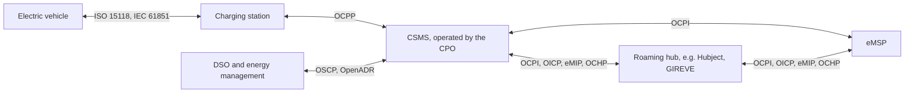

# Awesome EV Charging 

A carefully curated list of specifications, tools, and resources for electric vehicle (EV) charging protocols — a central point of information for developers and enthusiasts working in the e-mobility space.

## Contents

<!-- BEGIN GENERATED TOC -->
- [Specifications](#specifications)
  - [OCPP (Open Charge Point Protocol)](#ocpp-open-charge-point-protocol)
  - [OSCP (Open Smart Charging Protocol)](#oscp-open-smart-charging-protocol)
  - [ISO 15118](#iso-15118)
  - [OCPI (Open Charge Point Interface)](#ocpi-open-charge-point-interface)
  - [OICP (Open InterCharge Protocol)](#oicp-open-intercharge-protocol)
  - [eMIP (eMobility Protocol Inter-Operation)](#emip-emobility-protocol-inter-operation)
  - [eMI³ (eMobility ICT Interoperability)](#emi-emobility-ict-interoperability)
  - [NeMo (Hyper-Network for electroMobility)](#nemo-hyper-network-for-electromobility)
  - [Eichrecht](#eichrecht)
  - [OIOI (discontinued)](#oioi-discontinued)
- [Regulation & Standards Bodies](#regulation--standards-bodies)
  - [Regulatory Frameworks](#regulatory-frameworks)
  - [Technical Standards](#technical-standards)
  - [Standards Bodies & Industry Organizations](#standards-bodies--industry-organizations)
- [Smart Charging & Grid Integration](#smart-charging--grid-integration)
  - [Demand response and capacity exchange](#demand-response-and-capacity-exchange)
  - [Energy management and simulation](#energy-management-and-simulation)
  - [ISO 15118 & V2G](#iso-15118--v2g)
- [Testing & Conformance](#testing--conformance)
  - [Charge point and CSMS simulators](#charge-point-and-csms-simulators)
  - [Inspection and developer tests](#inspection-and-developer-tests)
  - [Certification and interoperability](#certification-and-interoperability)
  - [Security, metering and data models](#security-metering-and-data-models)
- [Tools and Resources](#tools-and-resources)
  - [OCPP](#ocpp)
  - [OCPI](#ocpi)
  - [iso15118](#iso15118)
  - [OICP](#oicp)
  - [Eichrecht](#eichrecht-1)
  - [OpenADR](#openadr)
  - [OSCP](#oscp)
  - [Other](#other)
  - [Uncategorized](#uncategorized)
<!-- END GENERATED TOC -->

The diagram below places each protocol on the link it covers, from the vehicle to the roaming partners and the grid.

For a comparison of the roaming protocols, see [EV roaming protocol differences](https://www.emobilitysimplified.com/2020/08/ev-roaming-protocol-differences-OCPI-OICP-OCHP-eMIP.html).

## Specifications

Some of the specifications below are vendored in this repository; the rights holder and licence of each vendored file are recorded in [docs/third-party-assets.md](docs/third-party-assets.md).

> **Archive notice.** The specification files in this repository are kept as an archive: several have already disappeared from their publishers' sites (eMI³, NeMo, OIOI), and copies like these were the only ones left. They are stored verbatim, with their original notices, and remain the property of their rights holders; the CC0 licence of this list does not cover them. If you hold rights to one of these files and object to its presence here, please [open an issue](https://github.com/juherr/awesome-ev-charging/issues/new) and it will be removed promptly.

### OCPP (Open Charge Point Protocol)

The **Open Charge Point Protocol (OCPP)** is a communication protocol between electric vehicle charging stations and a central management system.

- [Wikipedia](https://en.wikipedia.org/wiki/Open_Charge_Point_Protocol)
- Specifications
  - [2.1](https://github.com/juherr/awesome-ev-charging/tree/main/ocpp/OCPP-2.1) (2025-01)
  - [2.0.1](https://github.com/juherr/awesome-ev-charging/tree/main/ocpp/OCPP-2.0.1) (2020-04)
  - [2.0 (deprecated)](https://github.com/juherr/awesome-ev-charging/tree/main/ocpp/OCPP-2.0) (2018)
  - [1.6](https://github.com/juherr/awesome-ev-charging/tree/main/ocpp/OCPP-1.6) (2015)
  - [1.5 (deprecated)](https://github.com/juherr/awesome-ev-charging/tree/main/ocpp/OCPP-1.5) (2012)
  - [1.2 (deprecated)](https://github.com/juherr/awesome-ev-charging/tree/main/ocpp/OCPP-1.2) (2010)
- [Whitepapers](https://openchargealliance.org/ocpp-info-whitepapers/)
  - [Open and Interoperable Electric Vehicle Charging in Emerging Markets](https://openchargealliance.org/ocpp-info-whitepapers/open-and-interoperable-electric-vehicle-charging-in-emerging-markets/) (2026-09)
  - [Security Operations Guide](https://openchargealliance.org/ocpp-info-whitepapers/security-operations-guide/) (2026-09)
  - [Using OCPP with CHAdeMO](https://openchargealliance.org/ocpp-info-whitepapers/using-ocpp-with-chademo/) (2026-06)
  - [OCPP & QR Code Payment in Japan](https://openchargealliance.org/ocpp-info-whitepapers/ocpp-qr-code-payment-in-japan/) (2026-06)
  - [1.6 - Security Whitepaper Ed4](https://openchargealliance.org/ocpp-info-whitepapers/ocpp-1-6-security-whitepaper-4th-edition/) (2026-02)
  - [Migrating Charging Stations](https://openchargealliance.org/ocpp-info-whitepapers/migrating-charging-stations/) (2025-11)
  - [OCPP & M-PESA Mobile Payments](https://openchargealliance.org/ocpp-info-whitepapers/ocpp-m-pesa-mobile-payments/) (2025-11)
  - [OCPP & UPI Mobile Payments](https://openchargealliance.org/ocpp-info-whitepapers/ocpp-upi-mobile-payments/) (2025-11)
  - [OCPP 2.Lite - OCPP for Resource-Constrained Devices](https://openchargealliance.org/ocpp-info-whitepapers/ocpp-2-lite-ocpp-for-resource-constrained-devices/) (2025-07)
  - [OCPP & California Pricing Requirements](https://openchargealliance.org/ocpp-info-whitepapers/ocpp-california-pricing-requirements/) (2024-09)
  - [Improving Uptime Monitoring with OCPP](https://openchargealliance.org/ocpp-info-whitepapers/159297-2/) (2024-09)
  - [1.x - Multiple Connectors per EVSE](https://github.com/juherr/awesome-ev-charging/blob/main/ocpp/Whitepapers/ocpp_1_x_multiple_connectors_per_evse.pdf) (2024-03)
  - [AFIR and OCPP](https://openchargealliance.org/ocpp-info-whitepapers/afir-and-ocpp/) (2024-01)
  - [OCPP & UK Electric Vehicles (Smart Charge Points) Regulations 2021](https://openchargealliance.org/ocpp-info-whitepapers/159292-2/) (2023-09)
  - [OCPP & IEC 61850: A Winning Team](https://openchargealliance.org/ocpp-info-whitepapers/ocpp-iec-61850-a-winning-team/) (2023-09)
  - [What Is New in OCPP 2.0.1?](https://openchargealliance.org/ocpp-info-whitepapers/what-is-new-in-ocpp-2-0-1/) (2023-03)
  - [Mode 1&2-only Charging Station Added to OCPP Certification](https://openchargealliance.org/ocpp-info-whitepapers/new-mode-12-only-charging-station-added-to-ocpp-certification/) (2023-01)
  - [Integrating OCPP Chargers at Filling Stations](https://openchargealliance.org/ocpp-info-whitepapers/integrating-ocpp-chargers-at-filling-stations/) (2022-05)
  - [Using ISO 15118 Plug & Charge with OCPP 1.6](https://openchargealliance.org/ocpp-info-whitepapers/using-iso-15118-plug-charge-with-ocpp-1-6/) (2020-09)
  - [Customizing OCPP Implementations](https://openchargealliance.org/ocpp-info-whitepapers/customizing-ocpp-implementations/) (2020-06)
  - [Using OpenADR with OCPP](https://openchargealliance.org/ocpp-info-whitepapers/oca-using-openadr-with-ocpp/)
  - [The World's First Large-Scale Migration of OCPP-Based PEV Charging Infrastructure](https://openchargealliance.org/ocpp-info-whitepapers/the-worlds-first-large-scale-migration-of-ocpp-based-pev-charging-infrastructure/)
- [Configuration Keys (1.6)](https://github.com/juherr/awesome-ev-charging/blob/main/ocpp/OCPP-1.6-configuration-keys.md) - Reference table of OCPP 1.6 configuration keys.

### OSCP (Open Smart Charging Protocol)

The **Open Smart Charging Protocol (OSCP)** communicates forecasts of available capacity from a Capacity Provider, such as a distribution system operator, to a Flexibility Provider, such as a charging station management system, for capacity-based smart charging.

- Specifications
  - [2.0](https://github.com/juherr/awesome-ev-charging/tree/main/oscp/OSCP-2.0) (2020-10)
  - [1.0](https://openchargealliance.org/my-oca/oscp/) (2015-04)

### ISO 15118

**ISO 15118** is an international standard for communication between electric vehicles and the charging station.

- [Wikipedia](https://en.wikipedia.org/wiki/ISO_15118)
- [iso.org](https://www.iso.org/search.html?PROD_isoorg_en%5Bquery%5D=15118&PROD_isoorg_en%5Bmenu%5D%5Bfacet%5D=standard)

### OCPI (Open Charge Point Interface)

The **Open Charge Point Interface (OCPI)** is a protocol for roaming between charging station networks.
The next version is developed in the `ocpi-3` repository, which only [EVRoaming Foundation contributors](https://evroaming.org/how-to-join/) can access.

OCPI versions read `MAJOR.MINOR.PATCH`. A `-dN` suffix (`2.1.1-d2`, `2.2-d2`) marks a documentation update of the same specification: text and examples only, no protocol change. From 2.3.0 on, the core is also published in editions (`ed1`, `ed2`), where an edition may change messages, fields or datatypes. This edition scheme follows a CEN-CENELEC proposal that is [still under discussion](https://github.com/ocpi/ocpi/blob/2.3.0/release/core/README.md#versioning-of-the-230-documents).

- [Specifications on GitHub](https://github.com/ocpi/ocpi)
  - [2.3.0 Edition 2](https://github.com/ocpi/ocpi/releases/download/v2.3.0-ed2/OCPI-2.3.0-ed2.pdf) - Core edition 2, adds Invoice Reconciliation (2026-06).
  - [2.3.0 Edition 1](https://github.com/ocpi/ocpi/releases/download/v2.3.0-ed1/OCPI-2.3.0.pdf) - Core edition 1 without the Payments module, an internal release upstream (2026-06).
  - [2.3.0](https://evroaming.org/wp-content/uploads/2025/02/OCPI-2.3.0.pdf) - Original release, core edition 1 including the Payments module (2025-02).
  - [2.2.1](https://github.com/ocpi/ocpi/releases/download/2.2.1/OCPI-2.2.1.pdf) (2021-10)
  - [2.2.0-d2](https://github.com/ocpi/ocpi/releases/download/2.2-d2/OCPI-2.2-d2.pdf) - Deprecated, use 2.2.1 instead (2020-06)
  - [2.2.0](https://github.com/ocpi/ocpi/releases/download/2.2/OCPI-2.2.pdf) - Deprecated, use 2.2.0-d2 instead (2019-09)
  - [2.1.1-d2](https://github.com/ocpi/ocpi/releases/download/2.1.1-d2/OCPI_2.1.1-d2.pdf) (2019-06)
  - [2.1.1](https://github.com/ocpi/ocpi/releases/download/2.1.1/OCPI_2.1.1.pdf) - Deprecated, use 2.1.1-d2 instead (2017-06)
  - 2.1.0 - Deprecated, contains some bugs, use 2.1.1 instead (2016-04)
  - [2.0](https://github.com/ocpi/ocpi/files/135934/OCPI_2.0-d2.pdf) (2016-02)
  - Sources: the [`2.3.0/release/core`](https://github.com/ocpi/ocpi/tree/2.3.0/release/core), [`2.3.0/release/payments`](https://github.com/ocpi/ocpi/tree/2.3.0/release/payments) and [`2.3.0/release/bookings`](https://github.com/ocpi/ocpi/tree/2.3.0/release/bookings) branches are the source of truth for 2.3.0; fixes to earlier versions live on [`release-2.2.1-bugfixes`](https://github.com/ocpi/ocpi/tree/release-2.2.1-bugfixes), [`release-2.2-bugfixes`](https://github.com/ocpi/ocpi/tree/release-2.2-bugfixes) and [`release-2.1.1-bugfixes`](https://github.com/ocpi/ocpi/tree/release-2.1.1-bugfixes). The older `release-2.3.0-bugfixes` branch is frozen.
- [ocpi.github.io](https://ocpi.github.io/) - OCPI feature-development hub: proposals and processes for upcoming spec versions.
- Official OpenAPI/Swagger definitions and migration guides (rendered from the [openapi-specification](#api-specification) project).
  - [2.3.0 Swagger UI](https://ocpi.github.io/openapi-specification/ocpi/2.3.0/)
  - [2.2.1 → 2.3.0 migration guide](https://ocpi.github.io/openapi-specification/migrations/2.2.1-2.3.0/migration-guide.html)
  - [2.2.1 Swagger UI](https://ocpi.github.io/openapi-specification/ocpi/2.2.1/)
- [ocpi.fyi](https://ocpi.fyi/) - A browsable rendering of the OCPI specification with an API reference and version comparison. 🏅
  - [2.3.0 Swagger](https://ocpi.fyi/api/2.3.0/swagger/) (unofficial)
  - [2.2.1 Swagger](https://ocpi.fyi/api/2.2.1/swagger/) (unofficial)
  - [2.1.1 Swagger](https://ocpi.fyi/api/2.1.1/swagger/) (unofficial)

#### Modules

OCPI 2.3.0 is published as a [core specification](https://github.com/ocpi/ocpi/blob/2.3.0/release/core/README.md#specification-contents) plus functional modules that are packaged and released independently: each module package bundles a core edition with one module.

Besides the modules, the core defines the protocol meta information that connects the parties: [transport and format](https://github.com/ocpi/ocpi/blob/2.3.0/release/core/transport_and_format.asciidoc), [status codes](https://github.com/ocpi/ocpi/blob/2.3.0/release/core/status_codes.asciidoc), the [version information endpoint](https://github.com/ocpi/ocpi/blob/2.3.0/release/core/version_information_endpoint.asciidoc) and [credentials & registration](https://github.com/ocpi/ocpi/blob/2.3.0/release/core/credentials.asciidoc).

Core functional modules:

| Module                 | Specification per version                                           |
| ---------------------- | ------------------------------------------------------------------- |
| Locations              | [2.1.1][ocpi-loc-211], [2.2.1][ocpi-loc-221], [2.3.0][ocpi-loc-230] |
| Sessions               | [2.1.1][ocpi-ses-211], [2.2.1][ocpi-ses-221], [2.3.0][ocpi-ses-230] |
| CDRs                   | [2.1.1][ocpi-cdr-211], [2.2.1][ocpi-cdr-221], [2.3.0][ocpi-cdr-230] |
| Tariffs                | [2.1.1][ocpi-tar-211], [2.2.1][ocpi-tar-221], [2.3.0][ocpi-tar-230] |
| Tokens                 | [2.1.1][ocpi-tok-211], [2.2.1][ocpi-tok-221], [2.3.0][ocpi-tok-230] |
| Commands               | [2.1.1][ocpi-cmd-211], [2.2.1][ocpi-cmd-221], [2.3.0][ocpi-cmd-230] |
| Charging Profiles      | [2.2.1][ocpi-cp-221], [2.3.0][ocpi-cp-230]                          |
| Hub Client Info        | [2.2.1][ocpi-hci-221], [2.3.0][ocpi-hci-230]                        |
| Invoice Reconciliation | [2.3.0 (ed2)][ocpi-ir-230]                                          |

Additional modules (packaged separately). Payments and Bookings are optional and evolve independently of the core: each carries its own module version, and each PDF bundles it with one core edition. They are independent from each other and from Invoice Reconciliation — an implementation may support any of them on its own. The upstream [compatibility matrix](https://github.com/ocpi/ocpi/blob/2.3.0/release/core/README.md#compatibility-matrix) maps every document to its tag, branch, core edition and module version. Its release status lags behind: it still marks Edition 2 and Edition 2 Payments as planned and says the 2.3.0 tags are not GitHub Releases, while the PDFs linked here are published as releases.

- Payments 1 ([specification](https://github.com/ocpi/ocpi/blob/2.3.0/release/payments/mod_payments.asciidoc))
  - [With core edition 2](https://github.com/ocpi/ocpi/releases/download/v2.3.0-ed2-payments/OCPI-2.3.0-ed2-payments.pdf) (2026-06, tag `v2.3.0-ed2-payments`)
  - [With core edition 1](https://github.com/ocpi/ocpi/releases/download/v2.3.0-payments/OCPI-2.3.0-payments.pdf) - Same specification as the original 2.3.0 release (2026-06, tag `v2.3.0-payments`)
- Bookings ([specification](https://github.com/ocpi/ocpi/blob/2.3.0/release/bookings/mod_bookings.asciidoc))
  - Bookings 1.1 with core edition 2 - Not yet released
  - [Bookings 1.1 with core edition 1](https://evroaming.org/wp-content/uploads/2026/01/OCPI-2.3.0-booking-1.1.pdf) (2025-06, not yet tagged)
  - [Bookings 1 with core edition 1](https://github.com/ocpi/ocpi/releases/download/v2.3.0-bookings/OCPI-2.3.0-bookings.pdf) (2026-06, tag `v2.3.0-bookings`)

Extensions (vendor / community):

| Extension                          | OCPI version | Source    | Date    |
| ---------------------------------- | ------------ | --------- | ------- |
| [Direct Payment][ext-dp]           | 2.2.1        | EVRoaming | 2024-03 |
| [e-PoI service][ext-epoi]          | 2.2.1        | Gireve    | 2025-10 |
| [Accessibility extension][ext-acc] | 2.3.0, 3.0   | EVRoaming | 2025-12 |
| [Autocharge][ext-ac]               | 2.3.0        | Community | —       |

[ocpi-loc-211]: https://github.com/ocpi/ocpi/blob/release-2.1.1-bugfixes/mod_locations.md
[ocpi-loc-221]: https://github.com/ocpi/ocpi/blob/release-2.2.1-bugfixes/mod_locations.asciidoc
[ocpi-loc-230]: https://github.com/ocpi/ocpi/blob/2.3.0/release/core/mod_locations.asciidoc
[ocpi-ses-211]: https://github.com/ocpi/ocpi/blob/release-2.1.1-bugfixes/mod_sessions.md
[ocpi-ses-221]: https://github.com/ocpi/ocpi/blob/release-2.2.1-bugfixes/mod_sessions.asciidoc
[ocpi-ses-230]: https://github.com/ocpi/ocpi/blob/2.3.0/release/core/mod_sessions.asciidoc
[ocpi-cdr-211]: https://github.com/ocpi/ocpi/blob/release-2.1.1-bugfixes/mod_cdrs.md
[ocpi-cdr-221]: https://github.com/ocpi/ocpi/blob/release-2.2.1-bugfixes/mod_cdrs.asciidoc
[ocpi-cdr-230]: https://github.com/ocpi/ocpi/blob/2.3.0/release/core/mod_cdrs.asciidoc
[ocpi-tar-211]: https://github.com/ocpi/ocpi/blob/release-2.1.1-bugfixes/mod_tariffs.md
[ocpi-tar-221]: https://github.com/ocpi/ocpi/blob/release-2.2.1-bugfixes/mod_tariffs.asciidoc
[ocpi-tar-230]: https://github.com/ocpi/ocpi/blob/2.3.0/release/core/mod_tariffs.asciidoc
[ocpi-tok-211]: https://github.com/ocpi/ocpi/blob/release-2.1.1-bugfixes/mod_tokens.md
[ocpi-tok-221]: https://github.com/ocpi/ocpi/blob/release-2.2.1-bugfixes/mod_tokens.asciidoc
[ocpi-tok-230]: https://github.com/ocpi/ocpi/blob/2.3.0/release/core/mod_tokens.asciidoc
[ocpi-cmd-211]: https://github.com/ocpi/ocpi/blob/release-2.1.1-bugfixes/mod_commands.md
[ocpi-cmd-221]: https://github.com/ocpi/ocpi/blob/release-2.2.1-bugfixes/mod_commands.asciidoc
[ocpi-cmd-230]: https://github.com/ocpi/ocpi/blob/2.3.0/release/core/mod_commands.asciidoc
[ocpi-cp-221]: https://github.com/ocpi/ocpi/blob/release-2.2.1-bugfixes/mod_charging_profiles.asciidoc
[ocpi-cp-230]: https://github.com/ocpi/ocpi/blob/2.3.0/release/core/mod_charging_profiles.asciidoc
[ocpi-hci-221]: https://github.com/ocpi/ocpi/blob/release-2.2.1-bugfixes/mod_hub_client_info.asciidoc
[ocpi-hci-230]: https://github.com/ocpi/ocpi/blob/2.3.0/release/core/mod_hub_client_info.asciidoc
[ocpi-ir-230]: https://github.com/ocpi/ocpi/blob/2.3.0/release/core/mod_invoice_reconciliation.asciidoc
[ext-dp]: https://evroaming.org/wp-content/uploads/2024/10/DirectPayment_2_2_1___EVRF_version.pdf
[ext-epoi]: https://www.gireve.com/wp-content/uploads/2025/10/Gireve_Tech_ePoI-OCPI-2.2.1_ImplementationGuide_V1.1-_en.pdf
[ext-acc]: https://evroaming.org/wp-content/uploads/2026/01/e_accessibility_extension-1.0.0.pdf
[ext-ac]: https://ocpi.fyi/ocpi/2.3.0/extensions/mod_autocharge_roaming.html

#### Roaming

Roaming relies on ID Registration Offices (IDRO) that assign and publish the operator (CPO) and provider (eMSP) identifiers exchanged over OCPI.

- [Identification Registration Repository](https://alternative-fuels-observatory.ec.europa.eu/markets-and-policy/identification-registration-repository) - The European reference, maintained by the European Alternative Fuels Observatory.
- [IDRO Directory](https://idro.juherr.dev/) - A global directory aggregating e-mobility identifiers from national and regional IDRO registries.

Roaming platforms (hubs) that interconnect CPOs and eMSPs, by founding year:

- 🇩🇪 [Hubject](https://hubject.com/) (2012)
- 🇫🇷 [Gireve](https://gireve.com/) (2013)
- 🇩🇪 [e-clearing.net](https://www.e-clearing.net/) (2014)
- 🇩🇪 [eNAPI](https://enapi.com/) (2024)
- 🇫🇷 [CO-OP ev](https://www.co-opev.com/) (2026)

### OICP (Open InterCharge Protocol)

The **Open InterCharge Protocol (OICP)** is another protocol for roaming, developed by Hubject.

- [Specifications on GitHub](https://github.com/hubject/oicp)
  - [2.3](https://github.com/hubject/oicp/tree/master/OICP-2.3) (2020-10)
  - 2.2: [CPO](https://github.com/hubject/oicp/releases/download/v2.2/OICP-CPO-2.2.pdf), [EMP](https://github.com/hubject/oicp/releases/download/v2.2/OICP-EMP-2.2.pdf) (2017-10)
  - 2.1: [CPO](https://github.com/hubject/oicp/releases/download/v2.1/OICP-CPO-2.1.pdf), [EMP](https://github.com/hubject/oicp/releases/download/v2.1/OICP-EMP-2.1.pdf) (2016-10, retired 2023-04-13)

### eMIP (eMobility Protocol Inter-Operation)

The **eMobility Protocol Inter-Operation (eMIP)** is a roaming protocol developed by Gireve.

- [Protocol description v1.0.17](https://www.gireve.com/wp-content/uploads/2025/02/Gireve_Tech_eMIP-V0.7.4_ProtocolDescription_1.0.17-en.pdf) (2025-02)
- [Implementation guide v1.0.7](https://www.gireve.com/wp-content/uploads/2022/09/Gireve_Tech_eMIP-V0.7.4_ImplementationGuide_1.0.7_en.pdf) (2022-09)

### eMI³ (eMobility ICT Interoperability)

**eMI³ (eMobility ICT Interoperability)** was a European initiative for e-mobility interoperability.

- [Website (archived)](https://web.archive.org/web/20230925033629/http://emi3group.com/)
- [Document index](https://github.com/juherr/awesome-ev-charging/blob/main/emi3/README.md) - Every PDF the website published, with a verified archived copy where one survives.
- [Statement on quality of e-mobility service](https://github.com/juherr/awesome-ev-charging/blob/main/emi3/eMI3-statement-on-QoS-2020-final.pdf) - Using publicly accessible charging infrastructures (2020-06).
- Specifications
  - eMi³ standard version V1.1 electric vehicle ICT interface specifications (2019-10)
    - [Part 1 v1.1](https://github.com/juherr/awesome-ev-charging/blob/main/emi3/emi3-1.1/eMI3-standard-v1.1-Part-1.pdf)
    - [Terms and definitions v1.4](https://github.com/juherr/awesome-ev-charging/blob/main/emi3/emi3-1.1/eMI3-standard-TermsAndDefinitions-v1.4.pdf)
  - eMi³ standard version V1.0 electric vehicle ICT interface specifications (2019-10)
    - [Part 1 v1.0](https://github.com/juherr/awesome-ev-charging/blob/main/emi3/emi3-1.0/eMI3-standard-v1.0-Part-1.pdf)
    - [Part 2 v1.0](https://github.com/juherr/awesome-ev-charging/blob/main/emi3/emi3-1.0/eMI3-standard-v1.0-Part-2.pdf)
    - [Terms and definitions v1.0](https://github.com/juherr/awesome-ev-charging/blob/main/emi3/emi3-1.0/eMI3-standard-TermsAndDefinitions-v1.0.pdf)

### NeMo (Hyper-Network for electroMobility)

**NeMo (Hyper-Network for electroMobility)** was a European Horizon 2020 project (2016–2019) that defined a common information model and an open inter-roaming protocol to connect e-mobility platforms.

- [Website (archived)](https://web.archive.org/web/20230205021136/https://nemo-emobility.eu/)
- [Deliverables (archived)](https://web.archive.org/web/20230205021136/https://nemo-emobility.eu/deliverables/)
- [Document index](https://github.com/juherr/awesome-ev-charging/blob/main/nemo/README.md) - Every PDF the website published, with its original and archived links.
- Specifications
  - [D3.2 Open European Inter-Roaming Protocol](https://github.com/juherr/awesome-ev-charging/blob/main/nemo/NeMo-D3.2-Open-European-InterRoaming-Protocol_Final.pdf) - Draft (2017-12).
  - Common Information Models v1.0 (2017-09)
    - [D3.3 deliverable](https://github.com/juherr/awesome-ev-charging/blob/main/nemo/NeMo-D3.3-Common-Information-Models_Final.pdf)
    - [Standalone edition](https://github.com/juherr/awesome-ev-charging/blob/main/nemo/NeMo-Common-Information-Models-1.pdf) - Model chapters only, without the deliverable front matter.
  - [D2.3 Standards and protocols](https://github.com/juherr/awesome-ev-charging/blob/main/nemo/NeMo-D2.3-Standards-and-protocols_Final-subject-to-EC-approval.pdf) - Subject to EC approval (2019-10).
- Requirements and methodology
  - [D1.1 Use cases and actors' requirements](https://github.com/juherr/awesome-ev-charging/blob/main/nemo/NeMo-D1.1-Use-Cases-and-Actors_Final.pdf) (2017-06)
  - [D1.3 Interoperability and regulatory requirements](https://github.com/juherr/awesome-ev-charging/blob/main/nemo/NeMo-D1.3-Interoperability-and-Regulation-Requirements_Final.pdf) (2017-10)
  - [D7.1 Global adoption and self-certification methodology for CPOs and EMPs](https://github.com/juherr/awesome-ev-charging/blob/main/nemo/NeMo-D7.1-Global-adoption-and-self-cert-methodology_Final-subject-to-EC-approval.pdf) - Subject to EC approval (2019-02).
- Validation and tooling
  - [D6.3 Hyper-Network validation](https://github.com/juherr/awesome-ev-charging/blob/main/nemo/NeMo-D6.3-Hyper-Network-Validation_Final.pdf) (2019-11)
  - [Service Creation Tools manual](https://github.com/juherr/awesome-ev-charging/blob/main/nemo/NeMo_ServiceCreation_Manual_05_2018-1.pdf) (2018-05)

### Eichrecht

**Eichrecht** refers to German legal metrology requirements, including measurement and verification in charging transactions. See the German legal references below for scope; a signed meter-data format alone does not establish compliance.

- [Whitepaper](https://openchargealliance.org/wp-content/uploads/2024/03/Presentation_Eichrecht_Plugfest.pdf)
- [Signed Meter Values in OCPP](https://openchargealliance.org/wp-content/uploads/2025/02/signed_meter_values-v10.pdf)

### OIOI (discontinued)

- [Latest specifications](https://juherr.dev/oioi-documentation/)

## Regulation & Standards Bodies

Regulations, standards, certification schemes and recommendations have different roles. Standards are generally voluntary unless incorporated into law or a contract; certification applies to a defined product and scope. Applicability depends on jurisdiction, equipment, installation, funding and dates. The following links are official starting points, checked in November 2026.

### Regulatory Frameworks

#### European Union

- [Alternative Fuels Infrastructure Regulation (EU) 2023/1804 (AFIR)](https://eur-lex.europa.eu/eli/reg/2023/1804) - Binding regulation covering infrastructure deployment and, for publicly accessible recharging points, payment, pricing and data requirements with scope-specific deadlines.
- [Radio Equipment Directive 2014/53/EU (RED)](https://eur-lex.europa.eu/eli/dir/2014/53/oj/eng) - Directive governing radio equipment placed on the EU market, relevant to chargers with radio connectivity; assess the applicable equipment and essential requirements.
- [Cyber Resilience Act, Regulation (EU) 2024/2847 (CRA)](https://eur-lex.europa.eu/eli/reg/2024/2847/oj) - Binding cybersecurity framework for in-scope products with digital elements, potentially including connected charging equipment; Article 71 sets phased application dates, with general application from 11 December 2027.
- [Energy Performance of Buildings Directive (EU) 2024/1275 (EPBD)](https://eur-lex.europa.eu/eli/dir/2024/1275/oj/eng) - Recast directive whose Article 14 addresses recharging infrastructure, pre-cabling and smart charging for specified building and parking situations; national transposition determines local implementation.

#### France

- [IRVE decree No. 2017-26, consolidated text](https://www.legifrance.gouv.fr/loda/id/JORFTEXT000033860620) - National framework covering charging infrastructure and interoperability, including installation and maintenance qualifications under Article 22 with explicit exceptions; use the consolidated provisions for the installation concerned.
- [Order of 8 August 2024 on charging operator identifiers](https://www.legifrance.gouv.fr/jorf/id/JORFTEXT000050093258) - Assigns the French identifier allocation role to Avere-France following its merger with AFIREV, supporting interoperable identification of charging actors.

#### Germany

- [Mess- und Eichgesetz (MessEG)](https://www.gesetze-im-internet.de/messeg/BJNR272300013.html) - Binding legal framework for measuring instruments and their use, relevant to measured quantities used in commercial charging transactions.
- [Mess- und Eichverordnung (MessEV)](https://www.gesetze-im-internet.de/messev/BJNR201100014.html) - Implementing ordinance for placing measuring instruments on the market, use and verification; read together with MessEG and the installation's assessment scope.

#### United States

- [23 CFR Part 680 — National Electric Vehicle Infrastructure Standards and Requirements](https://www.ecfr.gov/current/title-23/chapter-I/subchapter-G/part-680) - Federal requirements covering installation, operation, interoperability, connectivity and data for NEVI and other covered federally funded charging projects; Section 680.102 defines applicability rather than all US chargers.

### Technical Standards

These are published standards or industry specifications, not blanket regulatory obligations. Editions below identify verified publications, not a promise that a given edition is required in every jurisdiction. Full standards may require purchase; consult each publisher for amendments and national adoptions.

- [IEC 61851-1:2017 — Electric vehicle conductive charging system, general requirements](https://webstore.iec.ch/en/publication/33644) - Published third edition covering EV supply equipment operation and electrical safety, within the multipart IEC 61851 series.
- [IEC 62196-1:2025 — Conductive charging connectors, general requirements](https://webstore.iec.ch/en/publication/86313) - Published fifth edition covering plugs, socket-outlets, vehicle connectors and inlets; connector-specific parts complement these general requirements.
- [ISO 15118-2:2014 — Network and application protocol requirements](https://www.iso.org/standard/55366.html) - Published vehicle-to-grid communication standard, confirmed in 2024; distinguish this edition from drafts of its revision and from the second-generation protocol.
- [ISO 15118-20:2022 — Second-generation network and application requirements](https://www.iso.org/standard/77845.html) - Published communication standard including bidirectional power-transfer message sequences; its publisher also lists a 2026 amendment.
- [DIN/TS 70121:2024-11 — Digital communication for CCS DC charging](https://www.dinmedia.de/en/pre-standard/din-ts-70121/379319307) - Published pre-standard replacing DIN SPEC 70121:2014-12; existing implementations may still target the older specification.
- [US Access Board EV charging design recommendations](https://www.access-board.gov/tad/ev/) - Technical assistance distinguishing existing accessibility requirements from additional recommended design practices; recommendations are not themselves a new binding accessibility standard.

Backend and roaming specifications remain in the existing Specifications section: OCPP connects chargers and management systems; OCPI and OICP connect roaming actors. Smart charging, grid integration and demand-response specifications are introduced in the guide below. Electrical metering references are under Eichrecht; cybersecurity requirements and certificate exchange are separate from proof of certification.

### Standards Bodies & Industry Organizations

Formal standards organizations:

- [IEC — International Electrotechnical Commission](https://www.iec.ch/) - Develops international electrotechnical standards, including charging equipment safety and connector series.
- [ISO — International Organization for Standardization](https://www.iso.org/about) - Develops international standards, including the ISO 15118 vehicle-to-grid communication family jointly with IEC.
- [SAE International](https://www.sae.org/standards) - Develops mobility standards and recommended practices, including North American charging interfaces.
- [CEN — European Committee for Standardization](https://www.cencenelec.eu/about-cen/) - Recognized European standardization organization covering non-electrotechnical fields, including transport and accessibility.
- [CENELEC — European Committee for Electrotechnical Standardization](https://www.cencenelec.eu/about-cenelec/) - Recognized European organization for electrotechnical standards and European adoptions of IEC work.
- [ETSI — European Telecommunications Standards Institute](https://www.etsi.org/about/) - Recognized European standardization organization working on telecommunications, connected equipment and cybersecurity.

Protocol governance bodies and industry associations:

- [Open Charge Alliance (OCA)](https://www.openchargealliance.org/) - Maintains OCPP and OSCP and operates the OCPP certification program.
- [EVRoaming Foundation](https://evroaming.org/) - Governs OCPI and supports interoperability between charging and mobility service providers.
- [CharIN](https://www.charin.global/) - Industry association advancing interoperable charging, Plug & Charge, V2G and conformance testing; distinct from ISO and IEC.
- [AFIREV identifier service, now operated by Avere-France](https://afirev.fr/) - French interoperability and identifier resource following the 2024 merger; an industry service rather than a formal standards organization.

## Smart Charging & Grid Integration

### Demand response and capacity exchange

- [OpenADR Alliance specifications](https://www.openadr.org/specification) - Industry demand-response specifications for Virtual Top Nodes (VTNs) and Virtual End Nodes (VENs), with OpenADR 2.0b and 3.x representing distinct protocol generations.
- [Open Smart Charging Protocol (OSCP)](https://openchargealliance.org/protocols/open-smart-charging-protocol/) - OCA specification for communicating available network capacity between grid or site actors and charging back offices; version 2.0 extends the original model. Specifications are listed under [OSCP](#oscp-open-smart-charging-protocol).

The generated OpenADR and OSCP categories separate these implementations from generic energy management. OpenLEADR's Rust implementation documents OpenADR 3.1 VEN and VTN roles; its earlier releases targeted 3.0. These versions should not be assumed interchangeable. The [LF Energy project status](https://lfenergy.org/projects/openleadr/) identifies the Python 2.0b implementation as currently unmaintained, so it belongs with historical resources rather than maintained recommendations. Neither a protocol implementation nor a developer test suite automatically confers OpenADR certification.

### Energy management and simulation

EMS software coordinates charging with generation, storage and site constraints. OpenEMS is listed under [Energy management](#energy-management); evcc provides solar-aware charging and load management. ACN-Sim, part of ACN Portal, models charging schedules against network constraints for algorithm research; it is not a charge-point protocol simulator or a complete grid power-flow solver. See the [Grid simulation candidates](legacy-projects.md#grid-simulation) in the secondary catalogue. The [content audit](docs/content-taxonomy-audit.md#verification-and-editorial-decisions) records verified capabilities and selection decisions.

### ISO 15118 & V2G

Vehicle-to-grid communication does not by itself prove bidirectional power transfer. Check the implemented ISO 15118 edition, EVCC (vehicle) or SECC (charger) role, supported services and power hardware. Plug & Charge also requires trust anchors, certificate handling and provisioning beyond a successful charging exchange.

The generated ISO 15118 category distinguishes communication stacks, EVCC/SECC simulators, EXI codecs, SLAC matching, trace inspection and security tests. libcbv2g encodes and decodes DIN 70121, ISO 15118-2 and ISO 15118-20 EXI messages in the [EXI codecs candidates](legacy-projects.md#exi-codecs); pyslac addresses [ISO 15118-3 matching](#slac). hubject/opcp documents certificate-service exchange, while the existing protocol stacks and simulators provide different parts of a test environment. Standalone EVerest libslac and libiso15118 repositories are archived: consult current EVerest development before selecting those historical components.

## Testing & Conformance

### Charge point and CSMS simulators

Charge-point simulators emulate the charger to exercise a CSMS; CSMS simulators emulate the backend to exercise a charger. In the existing Simulator groups, SAP's charging-stations simulator emulates charge points, PlugSecure's simulator lab supports both roles, and the historical brunoluiz/ocpp-server-tool emulates an OCPP 1.5 central system. These roles differ from a deployable production backend. A protocol library such as IZIVIA/ocpp-toolkit remains a library even when used to build tests.

### Inspection and developer tests

Message inspection groups contain OCPP DebugKit, CheckOCPP, dsV2Gshark and trace decoders. They help inspect, validate or replay exchanges; a valid trace does not demonstrate complete protocol conformance. Testing & conformance groups contain developer test suites such as tzi-OCTT, whose name does not establish OCA recognition, while Security testing groups cover fuzzing, packet injection and related research. These labels describe the tool's purpose, not an official approval.

### Certification and interoperability

- [OCA testing and certification FAQ](https://openchargealliance.org/faq/) - Explains OCTT and the official OCPP certification process through designated laboratories; passing developer tests or running OCTT independently does not grant certification.
- [CharIN conformance testing](https://www.charin.global/technology/charin-conformance-testing/) - Describes the association's conformance program and its defined scope, distinct from community ISO 15118 test utilities.

Interoperability exercises test combinations of independent implementations; conformance tests check defined specification requirements. Neither substitutes for electrical safety assessment, legal metrology approval or deployment-specific regulatory compliance.

### Security, metering and data models

Security & PKI remains a cross-cutting concern: protocol-specific security tools stay with their protocol, Plug & Charge certificate tooling stays with ISO 15118, and general security resources stay under Other. OCPP Security Profiles and TLS certificate requirements belong to the corresponding OCPP edition and security documents.

Metering & Billing uses the existing Eichrecht and OCPI categories: OCMF and signed-meter-value verification address measurement evidence; CDRs and tariffs address roaming and billing data. Verifying a signature is not a complete Eichrecht assessment, and a CDR is not a signed meter reading.

Data models & identifiers groups OECS charger-model schemas, French IRVE data schemas, DATEX II libraries and mobility identifier tools. OECS is a community schema, not a formal IEC/ISO standard. Reference datasets remain under Analytics & data, avoiding a separate category for each data source.

## Tools and Resources

This list features actively maintained, curated projects. Dormant, archived, or not-yet-reviewed projects are collected separately in [legacy-projects.md](legacy-projects.md). Charging Station Management Systems — source-available and commercial, with their OCA certificates, OCPP versions and API availability — are catalogued in [csms.md](csms.md).

<!-- BEGIN GENERATED PROJECTS -->
### OCPP

#### Server

- [steve-community/steve](https://github.com/steve-community/steve) - Open-source Java OCPP server implementation for managing electric vehicle charging stations, supporting OCPP 1.2–1.6 with user and RFID management (OCPP 1.2, 1.5, 1.6 · Java · ⭐ 1152).
- [lbbrhzn/ocpp](https://github.com/lbbrhzn/ocpp) - Home Assistant integration that connects to OCPP 1.6j, 2.0.1, and 2.1 compliant electric vehicle chargers for monitoring and control (Python · ⭐ 414).
- [citrineos/citrineos-core](https://github.com/citrineos/citrineos-core) - CitrineOS is an open-source modular OCPP 1.6 and 2.0.1 charging station management system with message routing, broker support, and an operator web interface (OCPP 1.6, 2.0.1, 2.1 · TypeScript · ⭐ 310).
- [dallmann-consulting/OCPP.Core](https://github.com/dallmann-consulting/OCPP.Core) - An OCPP 1.6J/2.0/2.1 server in .NET 10 with a Web-UI for charging station and token administration (OCPP 1.6, 2.0, 2.1 · C# · ⭐ 304).
- [EVtivity/evtivity-csms](https://github.com/EVtivity/evtivity-csms) - An OCPP 1.6/2.0.1/2.1 and OCPI 2.2.1/2.3.0 compliant Charging Station Management System with ISO 15118 Plug and Charge support, AI-powered operator dashboards, and driver portal (OCPP 1.6, 2.0.1, 2.1 · TypeScript · ⭐ 36).
- [apostoldevel/ocpp-cs](https://github.com/apostoldevel/ocpp-cs) - An OCPP 1.5, 1.6, and 2.0.1 Central System server implementation in C++20 with a built-in charge point emulator and Web UI (OCPP 1.5, 1.6, 2.0.1 · C++ · ⭐ 80).
- [ChargePi/ChargePi-go](https://github.com/ChargePi/ChargePi-go) - ChargePi is a modular Linux-based charging station framework implementing OCPP 1.6 with management UI and API for custom integrations (OCPP 1.6, 2.0.1, 2.1 · Go · ⭐ 55).
- [yuncitys/charging-cloud-web](https://github.com/yuncitys/charging-cloud-web) - YunCharge is an open-source charging station management and fee collection system that implements OCPP 1.5, 1.6, and 2.0 protocols to manage and bill charging sessions for both scooters and electric vehicles (OCPP 1.6, 2.0 · Vue · ⭐ 27).
- [srcfl/ftw](https://github.com/srcfl/ftw) - A local-first home energy management system with an embedded OCPP 1.6J + 2.0.1 server that coordinates solar, batteries, grid power, and EV charging on Raspberry Pi or Linux (OCPP 1.6, 2.0.1 · Go · ⭐ 24).
- [iobroker-community-adapters/ioBroker.ocpp](https://github.com/iobroker-community-adapters/ioBroker.ocpp) - An ioBroker adapter implementing an OCPP 1.6-J WebSocket server to connect and control compatible wallboxes and EV charging stations (OCPP 1.6 · TypeScript · ⭐ 21).
- [vampirebyte/rabbitmq-web-ocpp](https://github.com/vampirebyte/rabbitmq-web-ocpp) - A RabbitMQ plugin that implements a scalable OCPP-over-WebSockets server gateway, translating charge station connections to native AMQP messaging for distributed CSMS architectures (Erlang · ⭐ 19).
- [EVerest/ocpp-csms](https://github.com/EVerest/ocpp-csms) - A lightweight OCPP 1.6 and OCPP 2.0.1 Central Station Management System server that responds to chargepoint messages and generates ISO 15118 certificate installation responses for Plug&Charge demonstrations (OCPP 1.6, 2.0.1 · Python · ⭐ 18).
- [savekar-ev/OCPP-1.6-Charging-Point-Management-System](https://github.com/savekar-ev/OCPP-1.6-Charging-Point-Management-System) - A production-ready OCPP 1.6 Charge Point Management System with WebSocket server, REST API, and admin interface for managing EV chargers (OCPP 1.6 · TypeScript · ⭐ 17).
- [OpenChargingCloud/CSMSCLI](https://github.com/OpenChargingCloud/CSMSCLI) - A .NET-based charging station management system implementing OCPP and OCPI protocols to manage charging infrastructure and peer with e-mobility service providers (OCPP 1.6, 2.1 · C# · ⭐ 9).
- [davbauer/ocpp-manager](https://github.com/davbauer/ocpp-manager) - OCPP Manager is an open-source OCPP 1.6J charging station management server with HonoJS backend and SvelteKit frontend for station monitoring, RFID card authorization, and transaction tracking with CSV export (TypeScript · ⭐ 8).
- [SolarNetwork/solarnetwork-central](https://github.com/SolarNetwork/solarnetwork-central) - SolarNet is a centralized cloud platform for managing user accounts, provisioning nodes, and providing REST APIs for accessing energy data collected from distributed SolarNodes (Java · ⭐ 7).
- [unified-error-codes/csds](https://github.com/unified-error-codes/csds) - A charging station diagnostic platform that uses OCPP to collect unified error codes and telemetry from EVSEs and provides a backend service with a web dashboard for analyzing charging failures (Python · ⭐ 7).
- [Beep-Technologies/esteban-ocpp](https://github.com/Beep-Technologies/esteban-ocpp) - Golang-based OCPP server for managing EV charging points with administrative functions and extensible REST APIs (OCPP 2.0 · Go · ⭐ 5).
- [parklapp/steve-pluggable](https://github.com/parklapp/steve-pluggable) - Java OCPP 1.2–1.6 server for charge point and RFID user management, deployable as a web application or reusable Spring Boot library (OCPP 1.2, 1.5, 1.6 · Java · ⭐ 4).
- [juherr/evolve](https://github.com/juherr/evolve) - Java-based OCPP server implementation for managing electric vehicle charging infrastructure (Java · ⭐ 4).
- [mobilityhub-vn/ocpp-rs](https://github.com/mobilityhub-vn/ocpp-rs) - Production-grade Rust OCPP implementation with CSMS server, Charge Point simulator, and conformance tests (OCPP 1.6, 2.0.1 · Rust · ⭐ 4).
- [eveys-mobility/OCPP](https://github.com/eveys-mobility/OCPP) - OCPP-J 1.6/2.0.1 CSMS gateway service that manages charging-point WebSocket connections and exposes REST, gRPC, and Kafka APIs (OCPP 1.6, 2.0.1 · Python · ⭐ 3).
- [erik73/app-steve](https://github.com/erik73/app-steve) - Home Assistant add-on of the SteVe OCPP server for managing EV charging point communication (Dockerfile · ⭐ 3).
- [eliodecolli/Medinilla](https://github.com/eliodecolli/Medinilla) - An open-source ASP.NET Core CSMS backend implementing OCPP 2.0.1 for managing EV charging stations (OCPP 2.0.1 · C# · ⭐ 3).
- [elton-saraci/ocpp-central-system](https://github.com/elton-saraci/ocpp-central-system) - Spring Boot OCPP 1.6 central system for managing EV charge stations via WebSocket with REST API for monitoring, remote operations, and transactions (OCPP 1.6 · Java · ⭐ 3).
- [SukritJaAIproject/bpc-csms-cloud](https://github.com/SukritJaAIproject/bpc-csms-cloud) - An OCPP 1.6-J central system (CSMS) with operator console, customer mobile app, and integrated payment platform for managing EV charging stations (OCPP 1.6, 2.0.1 · Python · ⭐ 2).
- [juherr/steve-ocpp-csms-image](https://github.com/juherr/steve-ocpp-csms-image) - Docker container images for SteVe, an open-source OCPP Central System, compiled at build-time with automated runtime database migrations (Shell · ⭐ 2).
- [wimhaanstra/virtual-ocpp](https://github.com/wimhaanstra/virtual-ocpp) - A self-hosted OCPP 1.6j server for managing smart chargers as a local CSMS, with charging activity recording, backend proxying, and an integrated charger simulator (OCPP 1.6 · TypeScript · ⭐ 2).
- [LastProject-ESIEE/OCPPConfigurationServer](https://github.com/LastProject-ESIEE/OCPPConfigurationServer) - A Spring Boot application providing an OCPP WebSocket server for configuring and managing charge points (Java · ⭐ 1).
- [zeloscloud/zelos-extension-ocpp](https://github.com/zeloscloud/zelos-extension-ocpp) - An OCPP 1.6 and 2.0.1 Central Station Management System server extension for the Zelos App that manages connected charge points and streams their telemetry (OCPP 1.6, 2.0.1 · Python · ⭐ 1).
- [alexeimoisseev/ocpp-server-typescript](https://github.com/alexeimoisseev/ocpp-server-typescript) - An educational OCPP 1.6J and 2.0.1 server in TypeScript over WebSocket for learning the protocol and testing chargers (OCPP 1.6, 2.0.1 · TypeScript · ⭐ 1).
- [amolsurjuse/ocpp-service](https://github.com/amolsurjuse/ocpp-service) - Spring Boot microservice implementing an OCPP WebSocket server that manages charging station connections, routes OCPP messages, and executes remote commands for a Charging Station Management System (OCPP 2.0.1 · Java · ⭐ 1).
- [codetics-software/ev-server-lite](https://github.com/codetics-software/ev-server-lite) - A Kotlin/Spring Boot EV charging supervision server implementing OCPI 2.1.1 and OCPP 1.6/2.0.1 protocols, with a Next.js dashboard and PostgreSQL/MongoDB backend for managing stations, sessions, and payments (OCPP 1.6, 2.0.1 · Kotlin · ⭐ 1).
- [codetics-software/codetics-ocpp-rust](https://github.com/codetics-software/codetics-ocpp-rust) - A Rust implementation of OCPP 1.6, 2.0.1, and 2.1 that provides a production Charging Station Management System service and modular protocol libraries with smart charging, reservations, and TLS security support (OCPP 1.6, 2.0.1, 2.1 · Rust · ⭐ 1).
- [slash909uk/ocpp-domoticz-bridge](https://codeberg.org/slash909uk/ocpp-domoticz-bridge) - A bridge that enables the domoticz home automation system to control electric vehicle supply equipment (EVSE) via the OCPP protocol (Python · ⭐ 1).
- [citrineos/citrineos](https://github.com/citrineos/citrineos) - An open-source Charging Station Management System implementing OCPP 1.6 and 2.x protocols for communication between charging stations and management software (OCPP 1.6, 2.0.1 · ⭐ 159).

#### Simulator

- [SAP/e-mobility-charging-stations-simulator](https://github.com/SAP/e-mobility-charging-stations-simulator) - Node.js software to simulate and scale OCPP-J charging stations for testing and load testing (OCPP 1.6, 2.0, 2.0.1 · TypeScript · ⭐ 231).
- [monta-app/ocpp-emulator](https://github.com/monta-app/ocpp-emulator) - A Kotlin Multiplatform OCPP 1.6 and 2.0.1 charge point emulator with UI and message interception capabilities for testing and development (OCPP 1.6, 2.0.1 · Kotlin · ⭐ 182).
- [ozgurbayram/OCPPSimulator](https://github.com/ozgurbayram/OCPPSimulator) - Web-based OCPP 1.6 charge point simulator for testing Charge Station Management Systems and monitoring OCPP protocol communication (OCPP 1.6 · TypeScript · ⭐ 35).
- [solidstudiosh/ocpp-virtual-charge-point](https://github.com/solidstudiosh/ocpp-virtual-charge-point) - Node.js-based terminal simulator for OCPP charging stations (1.2/SOAP, 1.6, 2.0.1/2.1) with configurable connectors and schema validation (OCPP 1.2, 1.6, 2.0.1 · TypeScript · ⭐ 122).
- [shiv3/ocpp-cp-simulator](https://github.com/shiv3/ocpp-cp-simulator) - An OCPP charge point simulator supporting versions 1.6J, 2.0.1/2.1, and SOAP variants for AI agent testing, CI automation, and CSMS development, with browser UI, CLI, server, Docker, and MCP interfaces (OCPP 1.2, 1.5, 1.6, 2.0.1, 2.1 · TypeScript · ⭐ 48).
- [OpenChargingCloud/ChargingStationApp](https://github.com/OpenChargingCloud/ChargingStationApp) - An Electron-based virtual OCPP charging station for developer testing, with OCPP 1.6 support and newer protocol versions under development (OCPP 1.6, 2.0.1, 2.1 · TypeScript · ⭐ 42).
- [virta-ltd/charge-device-simulator](https://github.com/virta-ltd/charge-device-simulator) - A Python-based device simulator framework for charging protocol devices, with primary support for OCPP, deployable as Docker containers or for local execution (Python · ⭐ 21).
- [road-labs/chargestation-one](https://github.com/road-labs/chargestation-one) - A browser-based charging station simulator supporting OCPP 1.6 and OCPP 2.0.1 protocols with transaction management and meter data signing capabilities (OCPP 1.6, 2.0.1, 2.1 · Less · ⭐ 18).
- [c-jimenez/open-ocpp-simu](https://github.com/c-jimenez/open-ocpp-simu) - A simulator for OCPP charge points using the Open OCPP library, with MQTT-managed instances and a graphical supervision interface (C++ · ⭐ 16).
- [kwtycoon/kilowatt-tycoon](https://github.com/kwtycoon/kilowatt-tycoon) - Rust tycoon game and EV charging network simulator implementing OCPP 1.6J, OCPI 2.3.0, and OpenADR 3.0 for realistic protocol dataset generation (OCPP 1.6 · Rust · ⭐ 7).
- [PlugSecure-Inc/ocpp-simulator-lab](https://github.com/PlugSecure-Inc/ocpp-simulator-lab) - An OCPP simulator for testing Charge Points and Charge Point Management Systems across OCPP versions 1.6J, 2.0.1, and 2.1 with a web dashboard (OCPP 1.6, 2.0.1, 2.1 · Python · ⭐ 6).
- [ZhongRuoyu/ocppsim](https://github.com/ZhongRuoyu/ocppsim) - Terminal-based OCPP-J charge point simulator written in Rust for interactive CSMS testing and protocol development (OCPP 1.6, 2.0.1, 2.1 · Rust · ⭐ 5).
- [elton-saraci/ocpp-charge-point-simulator](https://github.com/elton-saraci/ocpp-charge-point-simulator) - Multi-station OCPP 1.6 charge point simulator with per-station REST API control, WebSocket connections to central systems, and web management console (OCPP 1.6 · Java · ⭐ 5).
- [vfg27/EmuOCPP](https://github.com/vfg27/EmuOCPP) - OCPP emulator supporting versions 1.6, 2.0, and 2.0.1 with security profiles, built on mininet for network topology simulation and packet inspection via Wireshark dissectors (OCPP 1.6, 2.0, 2.0.1 · Python · ⭐ 5).
- [flowionab/charge-point-simulator](https://github.com/flowionab/charge-point-simulator) - A high-fidelity OCPP charge point simulator for testing and developing EV charging infrastructure, supporting OCPP 1.6J with OCPP 2.0.1 and 2.1 in progress (OCPP 1.6, 2.0.1, 2.1 · Rust · ⭐ 4).
- [ReliON-Charging/everest-dcfc](https://github.com/ReliON-Charging/everest-dcfc) - A containerized multi-connector virtual DC fast charging station simulator based on EVerest with configurable OCPP support (1.6, 2.0.1, 2.1) and Node-RED dashboard for testing (OCPP 1.6, 2.0.1, 2.1 · C++ · ⭐ 4).
- [wirelane/ocpp-client-simulator](https://github.com/wirelane/ocpp-client-simulator) - Node.js command-line simulator of OCPP 1.6 charging stations that connects to an OCPP server via WebSocket for testing authorization, remote transactions, and meter values (OCPP 1.6 · JavaScript · ⭐ 3).
- [hlsxx/ocpp-charge-point-simulator](https://github.com/hlsxx/ocpp-charge-point-simulator) - Rust CLI tool simulating OCPP 1.6 charge points for testing charging station management backends, with configurable dynamic and idle operational modes (OCPP 1.6, 2.0.1, 2.1 · Rust · ⭐ 2).
- [mohsinali33226/ocpp-charging-operations-lab](https://github.com/mohsinali33226/ocpp-charging-operations-lab) - OCPP 1.6 learning lab that simulates a fleet of virtual charging stations against a Python CSMS with an operator dashboard for monitoring, remote operations, smart charging profiles and failure-recovery scenarios (OCPP 1.6, 2.0.1 · HTML · ⭐ 2).
- [I-Love-OCPP/Charge-Point-Simulator](https://github.com/I-Love-OCPP/Charge-Point-Simulator) - Charge-Point-Simulator is a charge point simulator web application bootstrapped from the React + TypeScript + Vite template, whose README contains only the template's default setup notes (TypeScript · ⭐ 1).

#### Libraries

##### C

- [tux-evse/afb-ocpp-ext](https://github.com/tux-evse/afb-ocpp-ext) - An AFB micro-service framework extension that adds OCPP 1.6 and 2.0.1 protocol transport support (OCPP 1.6, 2.0.1 · ⭐ 2).

##### C\#

- [OpenChargingCloud/WWCP_OCPP](https://github.com/OpenChargingCloud/WWCP_OCPP) - Library implementing OCPP v1.6, v2.0.1, and v2.1 with extensions for digital signatures, overlay networking, Eichrecht compliance, and WWCP gateway integration (OCPP 1.5, 1.6, 2.0.1, 2.1 · ⭐ 70).

##### C++

- [c-jimenez/open-ocpp](https://github.com/c-jimenez/open-ocpp) - Open-source C++ library implementing OCPP 1.6 and 2.0.1 protocols over WebSocket/JSON, with support for both charge points and central systems (OCPP 1.6, 2.0.1 · ⭐ 174).
- [matth-x/MicroOcpp](https://github.com/matth-x/MicroOcpp) - An OCPP 1.6 / 2.0.1 client library in portable C/C++ for microcontrollers and embedded systems, compatible with Espressif, Arduino, NXP, STM and Linux platforms (OCPP 1.6, 2.0.1 · ⭐ 547).
- [Tinkerforge/tfocpp](https://github.com/Tinkerforge/tfocpp) - C++ library implementing OCPP 1.6J protocol (Core and Smart Charging profiles) for embedded EV charging hardware (OCPP 1.6 · ⭐ 4).

##### Go

- [aliml92/ocpp](https://github.com/aliml92/ocpp) - Golang package implementing the Open Charge Point Protocol (OCPP) 1.6 and 2.0.1 with support for both charge point client and central system server architectures (OCPP 1.6, 2.0.1 · ⭐ 28).
- [ChargePi/ocpp-manager](https://github.com/ChargePi/ocpp-manager) - A Go library for managing OCPP configuration variables with validation, mandatory key enforcement, and versioning support across multiple OCPP profiles (OCPP 1.6, 2.0.1 · ⭐ 6).
- [shiv3/gocpp](https://github.com/shiv3/gocpp) - A Go library implementing OCPP 1.6, 2.0.1, and 2.1 with generics-first typed APIs for central systems and charge points, built-in JSON-schema validation, and pluggable storage/auth/observability adapters (OCPP 1.6, 2.0.1, 2.1 · ⭐ 6).
- [road-labs/ocppj-go](https://github.com/road-labs/ocppj-go) - Go library implementing the OCPP-J protocol for client and server communication over WebSockets with message serialization, parsing, and synchronicity enforcement (OCPP 1.6, 2.0.1 · ⭐ 4).
- [road-labs/ocpp-types-go](https://github.com/road-labs/ocpp-types-go) - Auto-generated Go library providing strongly-typed struct definitions for OCPP protocol messages across versions 1.5, 1.6, 2.0.1, and 2.1 (OCPP 1.5, 1.6, 2.0.1, 2.1 · ⭐ 3).
- [enesismail/ocpp-go](https://github.com/enesismail/ocpp-go) - Maintained fork of lorenzodonini/ocpp-go, with a restored build and stability fixes: a Go library for OCPP-J central systems and charge points (OCPP 1.6, 2.0.1, 2.1 · ⭐ 3).
- [aasanchez/ocpp16messages](https://github.com/aasanchez/ocpp16messages) - Type-safe Go library implementing OCPP 1.6 message types and validation for charge points (EVSE) and central systems (CSMS) (OCPP 1.6 · ⭐ 2).

##### Java

- [ChargeTimeEU/Java-OCA-OCPP](https://github.com/ChargeTimeEU/Java-OCA-OCPP) - Java library implementing the Open Charge-Point Protocol (OCPP) for building central systems and charge points, supporting versions 1.6, 2.0.1, and 2.1 with JSON and SOAP transports (OCPP 1.6, 2.0.1, 2.1 · ⭐ 381).

##### JavaScript

- [mikuso/ocpp-rpc](https://github.com/mikuso/ocpp-rpc) - Node.js client and server library implementing the WAMP-like RPC-over-WebSocket system of the OCPP-J protocols (OCPP 1.6J, OCPP 2.0.1J, OCPP 2.1) (OCPP 1.6, 2.0.1, 2.1 · ⭐ 134).
- [argonne-vci/node-red-contrib-ocpp](https://github.com/argonne-vci/node-red-contrib-ocpp) - Node-RED package providing OCPP 1.5 and 1.6 nodes for Central Systems and Charge Points (OCPP 1.5, 1.6 · ⭐ 37).
- [ampeco/cpd-ocpp](https://github.com/ampeco/cpd-ocpp) - Node.js library providing an abstraction layer for OCPP 1.6 JSON protocol implementation with server and client request/response validation (OCPP 2.0 · ⭐ 3).

##### Kotlin

- [monta-app/library-ocpp](https://github.com/monta-app/library-ocpp) - Kotlin library implementing OCPP 1.6 and 2.0.1 message handling with support for both synchronous and asynchronous request-response patterns (OCPP 1.6 · ⭐ 10).
- [IZIVIA/ocpp-toolkit](https://github.com/IZIVIA/ocpp-toolkit) - A Kotlin library implementing the Open Charge Point Protocol (OCPP) for both charging stations and CSMS across versions 1.2–2.0.1 with JSON and SOAP transport support (OCPP 1.2, 1.5, 1.6, 2.0 · ⭐ 46).
- [I-Love-OCPP/sdk-1.6j](https://github.com/I-Love-OCPP/sdk-1.6j) - A Kotlin library for implementing OCPP 1.6 JSON Central Systems with message dispatch and bidirectional charge point communication (OCPP 1.6 · ⭐ 1).

##### PHP

- [solutionforest/ocpp-php](https://github.com/solutionforest/ocpp-php) - A PHP library implementing the Open Charge Point Protocol (OCPP) 1.6 and 2.0.1 with modular components for building EV charging stations and central management systems (OCPP 1.6, 2.0, 2.0.1 · ⭐ 6).

##### Python

- [mobilityhouse/ocpp](https://github.com/mobilityhouse/ocpp) - Python library implementing the Open Charge Point Protocol (OCPP) versions 1.6, 2.0.1, and 2.1 (OCPP 1.6, 2.0.1, 2.1 · ⭐ 1052).
- [nader0913/ocpp-rag](https://github.com/nader0913/ocpp-rag) - MCP server providing semantic search and structured knowledge base for OCPP 1.6, 2.0.1, and related EV charging standards (OCPP 1.6, 2.0.1 · ⭐ 51).

##### Rust

- [tommymalmqvist/rust-ocpp](https://github.com/tommymalmqvist/rust-ocpp) - Rust library implementing Open Charge Point Protocol versions 1.6, 2.0.1, and 2.1 (WIP) with JSON schema validation (OCPP 1.6, 2.0.1, 2.1 · ⭐ 106).
- [flowionab/ocpp-client](https://github.com/flowionab/ocpp-client) - Rust library implementing OCPP client communication for charge points and charging station management systems, supporting versions 1.6J, 2.0.1, and 2.1 (OCPP 1.6, 2.0.1, 2.1 · ⭐ 8).
- [flowionab/ocpp-charge-point](https://github.com/flowionab/ocpp-charge-point) - A Rust library and framework for building OCPP 1.6 and 2.0.1 compliant EV charger firmware with integrated state management, transaction handling, and hardware abstraction (OCPP 1.6, 2.0.1, 2.1 · ⭐ 7).
- [hupe1980/ocpp-kit](https://github.com/hupe1980/ocpp-kit) - A Rust library providing multi-layer OCPP 1.6J, 2.0.1 and 2.1 protocol implementation with typed payloads, framing, protocol engine, WebSocket transport and optional domain logic for charging stations, CSMS backends and local controllers (OCPP 1.6, 2.0.1, 2.1 · ⭐ 5).

##### TypeScript

- [voltbras/ts-ocpp](https://github.com/voltbras/ts-ocpp) - TypeScript library implementing OCPP (Open Charge Point Protocol) v1.6 and v1.5 with central system and charge point APIs (⭐ 48).
- [jacoscaz/typed-ocpp](https://github.com/jacoscaz/typed-ocpp) - A TypeScript library for type-aware validation of OCPP 1.6, 2.0.1, and 2.1 messages using official JSON Schema documents with full type narrowing support (OCPP 1.6, 2.0, 2.1 · ⭐ 11).
- [connected-hil/ocpp-tools](https://github.com/connected-hil/ocpp-tools) - TypeScript library providing OCPP v1.6 and v2.0.1 message types generated from JSON schemas, with validation and RPC parsing utilities (OCPP 1.6, 2.0.1, 2.1 · ⭐ 8).
- [ocpptools/ocpptools](https://github.com/ocpptools/ocpptools) - Open-source TypeScript library and CLI packages for validating, simulating, and building OCPP 1.6J and 2.0.1 messages (OCPP 1.6, 2.0.1 · ⭐ 3).

#### Message inspection

- [vfg27/CheckOCPP](https://github.com/vfg27/CheckOCPP) - A Wireshark dissector for automatic OCPP packet inspection and compliance validation (OCPP 1.6, 2.0, 2.0.1 · Lua · ⭐ 13).
- [michael-adler/ha-ocpp-relay](https://github.com/michael-adler/ha-ocpp-relay) - A Home Assistant integration that relays and monitors OCPP protocol traffic between EV chargers and management servers (Python · ⭐ 8).
- [ocpp-debugkit/toolkit](https://github.com/ocpp-debugkit/toolkit) - Open-source developer toolkit for inspecting, analyzing, replaying, and reporting OCPP charging session traces with integrated failure detection and scenario evaluation (TypeScript · ⭐ 7).
- [open-ocpp-trace/specification](https://github.com/open-ocpp-trace/specification) - A versioned JSON/JSONL format specification for recording OCPP message exchanges with schema validation and conformance suites (JavaScript · ⭐ 4).
- [ocpp-debugkit/studio](https://github.com/ocpp-debugkit/studio) - A native desktop application for debugging and inspecting OCPP charging sessions with live WebSocket interception, message decoding, trace analysis, and protocol failure detection (OCPP 1.6 · Zig · ⭐ 4).
- [open-ocpp-trace/viewer](https://github.com/open-ocpp-trace/viewer) - Embeddable viewer library for Open OCPP Trace records with a framework-neutral core, React components, and standalone bundle for inspecting OCPP protocol messages and traces (TypeScript · ⭐ 1).
- [open-ocpp-trace/sdk](https://github.com/open-ocpp-trace/sdk) - A codec library for reading, validating and writing Open OCPP Trace records in JSON/JSONL format for recording OCPP message exchanges (TypeScript · ⭐ 1).

#### Testing & conformance

- [tzi-app/tzi-OCTT](https://github.com/tzi-app/tzi-OCTT) - Python pytest implementation of OCPP Conformance Test Tool (OCTT) scenarios for validating CSMS implementations against OCPP 2.0.1 and 1.6J specifications (OCPP 1.6, 2.0.1 · Python · ⭐ 11).
- [juherr/open-ocpp-tck](https://github.com/juherr/open-ocpp-tck) - An open-source OCPP conformance testing toolkit that validates CSMS implementations using 80 OCA-certified test scenarios with wire-level frame assertions and pluggable drivers (OCPP 1.6, 2.0.1 · TypeScript · ⭐ 6).
- [ChargePi/chargeflow](https://github.com/ChargePi/chargeflow) - A CLI tool for validating OCPP 1.6, 2.0.1, and 2.1 JSON messages against specification schemas and vendor-specific extensions (OCPP 1.6, 2.0.1, 2.1 · Go · ⭐ 4).
- [road-labs/ocpp-trace-replayer](https://github.com/road-labs/ocpp-trace-replayer) - CLI tool for replaying recorded OCPP protocol traces against a backend endpoint to validate behavior (OCPP 1.5, 1.6, 2.0.1, 2.1 · Go · ⭐ 3).
- [eliodecolli/ocpp-test-cases](https://github.com/eliodecolli/ocpp-test-cases) - AI-generated test cases for validating OCPP 2.0.1 protocol implementations, covering Transactions, Authorization, and Provision modules (OCPP 2.0.1 · Python · ⭐ 1).

#### Misc

- [EVerest/EVerest](https://github.com/EVerest/EVerest) - Modular open-source framework for EV charging infrastructure implementing OCPP 1.6/2.0.1/2.1 and ISO 15118 with hardware drivers and energy management (OCPP 1.6, 2.0.1, 2.1 · C++ · ⭐ 298).
- [evcc-io/evcc](https://github.com/evcc-io/evcc) - Open-source EV charging controller and local home energy management system with support for multiple chargers, solar inverters, battery systems, and home automation protocols (Go · ⭐ 7632).
- [OpenEVSE/openevse_esp32_firmware](https://github.com/OpenEVSE/openevse_esp32_firmware) - ESP32-based WiFi gateway firmware for OpenEVSE chargers with web dashboard, MQTT integration, OCPP 1.6-J support, solar divert, and energy management (OCPP 1.6 · C · ⭐ 284).
- [SmartEVSE/SmartEVSE-3](https://github.com/SmartEVSE/SmartEVSE-3) - Open-source firmware for Electric Vehicle Supply Equipment implementing OCPP 1.6j protocol with multi-phase charging and smart power management (OCPP 1.6 · C · ⭐ 240).
- [ChargeLab/OpenOCPP](https://github.com/ChargeLab/OpenOCPP) - Multi-platform embedded firmware implementing OCPP 1.6/2.0.1 for charging stations, with ESP32 reference implementation (OCPP 1.6, 2.0.1 · C++ · ⭐ 92).
- [alexeimoisseev/ocpp.md](https://github.com/alexeimoisseev/ocpp.md) - A structured OCPP 2.1, 2.0.1 and 1.6J knowledge base of field-level message schemas, sequence diagrams and smart-charging deep-dives, packaged as a Claude Code plugin and docs directory for AI coding agents (OCPP 1.6, 2.0.1, 2.1 · Python · ⭐ 32).
- [ocpp-balanz/ocpp-2w-proxy](https://github.com/ocpp-balanz/ocpp-2w-proxy) - A bidirectional OCPP proxy that forwards charger and server messages between a primary and secondary central management system (Python · ⭐ 18).
- [appspace/kwwhat](https://github.com/appspace/kwwhat) - A dbt project that transforms raw OCPP logs into charge-attempt, visit and uptime models with reliability and utilization metrics for EV charging (OCPP 1.6, 2.0.1, 2.1 · ⭐ 15).
- [joulo-nl/joulo-ocpp-proxy](https://github.com/joulo-nl/joulo-ocpp-proxy) - A lightweight OCPP WebSocket proxy that forwards charger connections to a primary CSMS backend while optionally mirroring traffic to secondary backends (OCPP 1.6, 2.0, 2.0.1 · TypeScript · ⭐ 15).
- [gyzod/ocpp2mqtt](https://github.com/gyzod/ocpp2mqtt) - A Python gateway that converts OCPP 1.6 messages to MQTT and vice versa for integration with home automation systems (OCPP 1.6 · Python · ⭐ 11).
- [chargex-consortium/ev-charge-seq-state](https://github.com/chargex-consortium/ev-charge-seq-state) - UML sequence diagrams and finite-state machines documenting OCPP 1.6J/2.0.1/2.1, ISO 15118-2/20, and SAE J1772 PWM charging protocols (OCPP 1.6, 2.0.1, 2.1 · ⭐ 8).
- [OpenChargingTechnology/Whitepapers](https://github.com/OpenChargingTechnology/Whitepapers) - A repository of open technical whitepapers on EV charging infrastructure covering cybersecurity, protocol design, cryptographic mechanisms, and regulatory compliance including OCPP and OCPI (OCPP 1.6, 2.1 · Python · ⭐ 5).
- [sepehr-safari/ocpp-handbook](https://github.com/sepehr-safari/ocpp-handbook) - A free educational course on EV charging software fundamentals, covering industry context, protocols (OCPP, OCPI, ISO 15118), and field debugging (OCPP 1.6, 2.0.1 · JavaScript · ⭐ 3).
- [SukritJaAIproject/OCPP_CP_DUAL_CSMS](https://github.com/SukritJaAIproject/OCPP_CP_DUAL_CSMS) - An OCPP 1.6J charge point controller implemented in Python that connects to two CSMS simultaneously while ensuring each charging session belongs to exactly one platform (OCPP 1.6 · Python · ⭐ 2).
- [codetics-software/electric-mobility](https://github.com/codetics-software/electric-mobility) - A skill library of OCPP and OCPI implementation guidance, field reference cards, and security frameworks for electric mobility platform development (Python · ⭐ 2).
- [OpenChargingTechnology/OCPP-SBOM](https://github.com/OpenChargingTechnology/OCPP-SBOM) - Provides CycloneDX and SPDX Software Bill of Materials representations of the OCPP 2.1 Edition 2 specification bundle with SHA-256 hashes for PDFs, schemas, and appendices (OCPP 2.1 · ⭐ 1).

### OCPI

#### Server

- [citrineos/citrineos-ocpi](https://github.com/citrineos/citrineos-ocpi) - CitrineOS OCPI is a set of TypeScript modules that implement the OCPI 2.2.1 CPO (Charging Point Operator) protocol on top of CitrineOS Core, providing sender and receiver interface endpoints for sessions, CDRs, tariffs, locations, commands, and tokens with GraphQL API access and PostgreSQL event notifications (OCPI 2.2.1 · TypeScript · ⭐ 23).
- [olisystems/ocn-node-v2](https://github.com/olisystems/ocn-node-v2) - An OCPI v2.2 broker service written in Kotlin and Spring Boot that routes traffic between charging network parties and integrates with the OCN Registry, featuring a plugin architecture for custom endpoints and modules (OCPI 2.2 · Kotlin · ⭐ 1).
- [olisystems/ocn-registry-v2.0](https://github.com/olisystems/ocn-registry-v2.0) - A decentralized Ethereum-based smart contract registry that enables OCPI parties and Open Charging Network node operators to register, verify, and discover each other (TypeScript · ⭐ 1).

#### Simulator

- [savekar-ev/OCPI-2.2.1-EMSP-Simulator](https://github.com/savekar-ev/OCPI-2.2.1-EMSP-Simulator) - A Python-based OCPI 2.2.1 EMSP simulator for validating CPO protocol compliance, credentials handshake, and schema correctness (OCPI 2.2.1 · Python · ⭐ 10).
- [rally-finance/ocpi-mock-hub](https://github.com/rally-finance/ocpi-mock-hub) - A mock OCPI 2.2.1 hub server in Go that simulates OCPI party interactions and location management for development and testing of integrations (OCPI 2.2.1 · Go · ⭐ 5).

#### Libraries

##### C\#

- [OpenChargingCloud/WWCP_OCPI](https://github.com/OpenChargingCloud/WWCP_OCPI) - Implementation of Open Charge Point Interface (OCPI) versions 2.1 through 3.0 with WWCP bridging and Eichrecht compliance support (OCPI 2.0, 2.1, 2.1.1, 2.2, 2.2.1, 2.3.0 · ⭐ 29).
- [BitzArt/OCPI.Net](https://github.com/BitzArt/OCPI.Net) - A .NET library implementing the OCPI protocol for charging infrastructure integration in C# (⭐ 27).

##### Go

- [shiv3/gocpi](https://github.com/shiv3/gocpi) - A Go library providing typed OCPI 2.1.1/2.2.1/2.3.0 client and server implementations generated from official OpenAPI specifications (OCPI 2.1.1, 2.2.1, 2.3.0 · ⭐ 3).

##### Java

- [steve-community/ocpi-models](https://github.com/steve-community/ocpi-models) - A Java library providing OCPI 2.2.1 data models, Spring MVC API mappings, and RestTemplate clients for roaming and interoperability applications (OCPI 2.2.1 · ⭐ 3).

##### Kotlin

- [IZIVIA/ocpi-toolkit](https://github.com/IZIVIA/ocpi-toolkit) - Kotlin library implementing OCPI 2.2.1 protocol with business logic, validation rules, and framework-agnostic transport (OCPI 2.2.1 · ⭐ 39).

##### PHP

- [mrbig/ocpi-protocol](https://github.com/mrbig/ocpi-protocol) - A PHP library providing OCPI request/response classes and models for implementing eMSP and CPO server interfaces (OCPI 2.2.1 · ⭐ 2).

##### Python

- [TECHS-Technological-Solutions/ocpi](https://github.com/TECHS-Technological-Solutions/ocpi) - A Python library implementing the Open Charge Point Interface (OCPI) protocol with CRUD operations and adapter patterns for integrating with central charging station management systems (⭐ 64).
- [elumobility/ocpi-python](https://github.com/elumobility/ocpi-python) - A Python library implementing the OCPI protocol with FastAPI and Pydantic v2, supporting versions 2.3.0, 2.2.1, and 2.1.1 for CPO, EMSP, and payment terminal provider roles (OCPI 2.1.1, 2.2.1, 2.3.0 · ⭐ 8).
- [evorada/ocpi-types](https://github.com/evorada/ocpi-types) - Auto-generated OCPI protocol type definitions and language bindings for Go, Python, Rust, and TypeScript across OCPI versions 2.1.1, 2.2.1, and 2.3.0 (OCPI 2.3.0 · ⭐ 5).

##### Rust

- [mobilityhub-vn/ocpi-rs](https://github.com/mobilityhub-vn/ocpi-rs) - A Rust library implementing the OCPI protocol with typed models, async client, server handlers, and CLI support for versions 2.0 through 2.3.0 (OCPI 2.0, 2.1.1, 2.2.1, 2.3.0 · ⭐ 4).
- [tandemdrive/ocpi-tariffs](https://codeberg.org/tandemdrive/ocpi-tariffs) - A Rust library and CLI tool for calculating OCPI tariffs and pricing breakdowns from charging records according to OCPI 2.2.1 and 2.1.1 specifications (OCPI 2.1.1, 2.2.1 · ⭐ 4).
- [hupe1980/ocpi-kit](https://github.com/hupe1980/ocpi-kit) - A Rust library providing OCPI protocol types, client, server, roaming hub components, and auditable tariff engine for EV charging networks (OCPI 2.1.1, 2.2.1, 2.3.0 · ⭐ 1).

#### Misc

- [Quentin-BACQUET/GIREVE_Tech_OCPI_V2.2.1](https://github.com/Quentin-BACQUET/GIREVE_Tech_OCPI_V2.2.1) - GIREVE's implementation and integration guide for OCPI 2.2.1 protocols covering technical specifications, operational procedures and module details for CPO and eMSP participants in the roaming platform (OCPI 2.2.1 · ⭐ 2).
- [ocpi/ocpi-tool](https://github.com/ocpi/ocpi-tool) - A command-line tool for extracting data from OCPI platforms with privacy filtering, enabling CPOs to build secure data-export pipelines (OCPI 2.2.1 · TypeScript · ⭐ 33).
- [solidstudiosh/ocpi-schema](https://github.com/solidstudiosh/ocpi-schema) - A Node.js tool that generates JSON Schemas for OCPI 2.1.1 and onwards (TypeScript · ⭐ 20).
- [OpenChargingCloud/OCPIExplorerDesktopApp](https://github.com/OpenChargingCloud/OCPIExplorerDesktopApp) - A desktop application for testing and certifying OCPI protocol implementations across multiple protocol versions (OCPI 2.1, 2.1.1, 2.2, 2.2.1, 2.3.0 · TypeScript · ⭐ 5).
- [Quentin-BACQUET/GIREVE_Tech_OCPI_V2.1.1](https://github.com/Quentin-BACQUET/GIREVE_Tech_OCPI_V2.1.1) - GIREVE's OCPI 2.1.1 implementation guide with technical specifications and integration guidelines for CPO and eMSP roaming hub integration (OCPI 2.1.1 · ⭐ 5).
- [OpenChargingCloud/OCPIExplorerWebApp](https://github.com/OpenChargingCloud/OCPIExplorerWebApp) - A web-based explorer and testing tool for validating OCPI (Open Charge Point Interface) protocol implementations across multiple versions (OCPI 2.1, 2.1.1, 2.2.1, 2.3.0 · TypeScript · ⭐ 2).
- [juherr/ocpi-fyi](https://github.com/juherr/ocpi-fyi) - Multi-version Antora documentation site for OCPI protocol specifications with automatic GitHub Pages deployment (OCPI 2.1.1, 2.2.1, 2.3.0 · JavaScript · ⭐ 2).
- [ikarius/httpie-ocpi-auth](https://codeberg.org/ikarius/httpie-ocpi-auth) - An HTTPie authentication plugin that adds the OCPI token Authorization header to API requests (OCPI 2.2 · Python · ⭐ 0).

### iso15118

#### Plug&Charge

- [hubject/opcp](https://github.com/hubject/opcp) - Open-source specification for the Open Plug&Charge Protocol (OPCP), standardizing Plug&Charge certificate provisioning and interoperability based on ISO 15118-2 (JavaScript · ⭐ 73).

#### Simulator

- [Sevenstax/FreeV2G](https://github.com/Sevenstax/FreeV2G) - FreeV2G is a Python reference implementation that controls 8devices WHITE-BEET ISO15118 EVSE and EV embedded modules and simulates charger voltage and current behavior during EV charging sessions (Python · ⭐ 71).
- [IdahoLabResearch/AcCCS](https://github.com/IdahoLabResearch/AcCCS) - Emulation tools for ISO 15118 (CCS) Electric Vehicle and Supply Equipment Communication Controllers designed for protocol and security testing (Python · ⭐ 20).

#### Libraries

##### Python

- [ecog-io/iso15118](https://github.com/ecog-io/iso15118) - A Python library implementing the ISO 15118 -2 and -20 communication protocols with runnable SECC and EVCC protocol simulators (⭐ 250).

##### Rust

- [hupe1980/iso15118](https://github.com/hupe1980/iso15118) - Sans-I/O, no_std-capable Rust crate implementing the ISO 15118-2 and -20 protocol stack for both vehicle (EVCC) and station (SECC) roles, with schema-informed EXI codec, SLAC, V2GTP framing, session engines and Plug & Charge PKI (⭐ 3).

#### EXI codecs

- [EVerest/cbexigen](https://github.com/EVerest/cbexigen) - CbExiGen is a code generator that creates codec libraries for encoding and decoding Efficient XML Interchange (EXI) messages for ISO 15118 Vehicle To Grid communication (Python · ⭐ 71).
- [EVerest/libcbv2g](https://github.com/EVerest/libcbv2g) - An EXI encoding and decoding library for DIN 70121, ISO 15118-2 and ISO 15118-20 charging messages (C · ⭐ 36).
- [IdahoLabResearch/EXPy](https://github.com/IdahoLabResearch/EXPy) - Python library for encoding and decoding EXI messages in V2G charging protocols (DIN 70121, ISO 15118-2, ISO 15118-20) (Python · ⭐ 3).

#### SLAC

- [ecog-io/pyslac](https://github.com/ecog-io/pyslac) - A Python implementation of the Signal Level Attenuation Characterisation (SLAC) protocol specified in ISO 15118-3 (Python · ⭐ 56).

#### Message inspection

- [uhi22/pyPLC](https://github.com/uhi22/pyPLC) - A Python tool for investigating ISO 15118 / CCS charging protocols through traffic sniffing, EVSE and vehicle simulation, and powerline adaptor firmware patching (Python · ⭐ 241).
- [dspace-group/dsV2Gshark](https://github.com/dspace-group/dsV2Gshark) - A Wireshark plugin for decoding and analyzing ISO 15118-2/-20 and DIN 70121 vehicle-to-grid protocol messages between electric vehicles and charging stations (C++ · ⭐ 115).
- [SukritJaAIproject/EV_Charger_Fault_Detection_AI](https://github.com/SukritJaAIproject/EV_Charger_Fault_Detection_AI) - Offline Windows application for diagnosing DC EV charging failures by analyzing ISO 15118 protocol captures with AI-based anomaly detection (Python · ⭐ 2).
- [zeloscloud/zelos-extension-v2g](https://github.com/zeloscloud/zelos-extension-v2g) - A Zelos agent extension that decodes ISO 15118-2 and DIN 70121 V2G protocol messages from packet captures into plottable, queryable traces, with support for SLAC pairing and SocketCAN frame decoding (Python · ⭐ 1).

#### Testing & conformance

- [SwitchEV/RISE-V2G](https://github.com/SwitchEV/RISE-V2G) - RISE V2G is an open-source reference implementation of ISO 15118 for Vehicle-to-Grid communication between electric vehicles and charging equipment (Java · ⭐ 261).
- [OpenChargingCloud/ISO15118ConformanceTests](https://github.com/OpenChargingCloud/ISO15118ConformanceTests) - C#/.NET conformance and interoperability test suite for the WWCP_ISO15118 stack that replays a recorded EXI frame corpus, runs loopback end-to-end ISO 15118-2/-20 sessions and cross-checks live against Josev, EVerest, eVDriveFlow and tux-evse (C# · ⭐ 5).

#### Security testing

- [konicst1/ChargeSploit](https://github.com/konicst1/ChargeSploit) - A security testing tool that simulates the ISO 15118-2 and DIN SPEC 70121 V2G charging stack for EVSE and EVCC operation with message inspection and manipulation capabilities (Python · ⭐ 7).

#### Misc

- [securityinmobility/dc-charging-station](https://github.com/securityinmobility/dc-charging-station) - Python DC charging station controller implementing ISO15118 protocol with hardware abstraction for an EVAcharge SE, EA-PSB bidirectional power supply, and Plug & Charge PKI (Python · ⭐ 10).
- [uhi22/ccs32clara](https://github.com/uhi22/ccs32clara) - Firmware for STM32 microcontroller that implements ISO 15118 CCS charging protocol communication via power line communication (PLC) with a QCA7005 modem (C · ⭐ 118).

### OICP

#### Libraries

##### C\#

- [OpenChargingCloud/WWCP_OICP](https://github.com/OpenChargingCloud/WWCP_OICP) - A .NET library providing a reference implementation of the Open Intercharge Protocol (OICP v2.3) for Charge Point Operators, E-Mobility Providers, and Central Services in EV charging networks (⭐ 13).

### Eichrecht

#### Libraries

##### JavaScript

- [BSVKey/ocmf-kit](https://github.com/BSVKey/ocmf-kit) - A TypeScript/JavaScript library for generating and verifying OCMF signed meter readings (German Eichrecht format), with test modes, OCPP 1.6/2.x mappings, and a browser-based checker (⭐ 1).

##### TypeScript

- [road-labs/ocmf-js](https://github.com/road-labs/ocmf-js) - A TypeScript/JavaScript library implementing the Open Charge Metering Format (OCMF) specification with cryptographic signing and verification of metered energy data (⭐ 3).
- [OpenChargingCloud/ChargyCore.TS](https://github.com/OpenChargingCloud/ChargyCore.TS) - TypeScript library that validates cryptographic signatures and ensures Eichrecht-compliant transparency of e-mobility charging processes, supporting multiple charge data formats (⭐ 2).

#### Misc

- [SAFE-eV/OCMF-Open-Charge-Metering-Format](https://github.com/SAFE-eV/OCMF-Open-Charge-Metering-Format) - Collaborative markdown specification of the Open Charge Metering Format (OCMF) for EV charging meter transparency (⭐ 33).

### OpenADR

#### VEN & VTN

- [OpenLEADR/openleadr-python](https://github.com/OpenLEADR/openleadr-python) - A Python library implementing the OpenADR 2.0b protocol with both VEN (client) and VTN (server) components for demand-response coordination (Python · ⭐ 161).
- [OpenLEADR/openleadr-rs](https://github.com/OpenLEADR/openleadr-rs) - A Rust implementation of OpenADR 3.1 providing a VEN client library and a VTN server, with earlier releases targeting OpenADR 3.0 (Rust · ⭐ 107).
- [universaldevices/oadr30](https://github.com/universaldevices/oadr30) - Python library implementing an OpenADR 3.0 Virtual End Node (VEN) for demand response integration with test support for certification and price-based signals (Python · ⭐ 10).
- [hupe1980/openadr](https://github.com/hupe1980/openadr) - Rust library implementing OpenADR 3.1 with both VTN server and VEN runtime components (Rust · ⭐ 1).

#### Misc

- [grid-coordination/openadr3-specification](https://github.com/grid-coordination/openadr3-specification) - Public copy of the OpenADR 3 specification providing OpenAPI definitions and Definition/User Guide documentation (⭐ 1).

### OSCP

#### Libraries

##### Makefile

- [ChargePi/oscp-go](https://github.com/ChargePi/oscp-go) - A Go SDK providing OSCP-compatible server and client code generated from OpenAPI specifications (⭐ 4).

### Other

#### Analytics & data

- [vbalagovic/cars-dataset](https://github.com/vbalagovic/cars-dataset) - A vehicle specifications dataset and query API covering 54,000+ vehicles across 370+ brands from 1898–2026, with European market price listings (⭐ 29).
- [robeertm/ev-charge-tracker](https://github.com/robeertm/ev-charge-tracker) - A self-hosted web dashboard for tracking electric vehicle charging sessions, costs, CO2 emissions, and battery health by integrating with 15 vehicle manufacturer APIs (Python · ⭐ 13).
- [MTES-MCT/qualicharge](https://github.com/MTES-MCT/qualicharge) - QualiCharge is a French government data analytics platform that collects and analyzes EV charging infrastructure supervision data to provide dashboards, APIs, and insights for charging service quality improvement (Python · ⭐ 10).
- [chaser-d/Green_Smart_Grid_Simulator](https://github.com/chaser-d/Green_Smart_Grid_Simulator) - A dbt and DuckDB ELT pipeline that ingests, validates and aggregates solar, wind and hydroelectric smart-grid telemetry into financial reporting marts using a Medallion Architecture (HTML · ⭐ 3).
- [rajvvv/EV-Infra-Planner](https://github.com/rajvvv/EV-Infra-Planner) - A geospatial analytics dashboard that forecasts EV adoption and identifies charging infrastructure deployment gaps across Indian cities to guide policy and infrastructure planning (JavaScript · ⭐ 3).
- [JamieTighe/ev-charging-demand-uk](https://github.com/JamieTighe/ev-charging-demand-uk) - Data analytics pipeline comparing UK public EV charging supply against private BEV ownership by local authority, using PostgreSQL, Python, and Tableau dashboards to identify coverage gaps and investment priorities (Jupyter Notebook · ⭐ 2).
- [GuillaumeBraillon/EV-Charge-Tracker](https://github.com/GuillaumeBraillon/EV-Charge-Tracker) - A personal web application for tracking, analyzing and estimating electric vehicle charging costs with realistic pricing based on actual usage data (TypeScript · ⭐ 1).

#### Battery

- [dalathegreat/Battery-Emulator](https://github.com/dalathegreat/Battery-Emulator) - Firmware that enables used EV battery packs to be repurposed as stationary energy storage systems compatible with home solar inverters (C++ · ⭐ 3034).
- [mnh-jansson/open-battery-information](https://github.com/mnh-jansson/open-battery-information) - Arduino firmware and web-based tools for diagnosing battery health, reading battery models and cell voltages, and unlocking BMS fault codes for battery repair (C++ · ⭐ 1835).
- [remontsuri/EV-QA-Framework](https://github.com/remontsuri/EV-QA-Framework) - Python framework for EV battery quality assurance with ML-powered anomaly detection, state-of-health prediction, CAN bus simulation, and compliance testing (Python · ⭐ 9).

#### Charging management system

- [roy429-hub/buima-tracker](https://github.com/roy429-hub/buima-tracker) - A web-based operations dashboard for tracking and analyzing EV charging installations with automated session detection and KPI computation from xlsx reports (JavaScript · ⭐ 1).
- [artmakerzbr/ev-tracker](https://github.com/artmakerzbr/ev-tracker) - A web and mobile application for tracking EV charging sessions and calculating charges to a condominium (JavaScript · ⭐ 1).

#### Data models & identifiers

- [open-ev-data/open-ev-data-dataset](https://github.com/open-ev-data/open-ev-data-dataset) - An open dataset of electric vehicle specifications authored as layered JSON fragments and compiled into canonical vehicle records (JavaScript · ⭐ 32).
- [etalab/schema-irve](https://github.com/etalab/schema-irve) - A French government data schema repository defining static location/characteristics, dynamic status/availability, and tariff data structures for EV charging infrastructure (IRVE) published to data.gouv.fr (Elixir · ⭐ 14).
- [gaia-charge/evdb](https://github.com/gaia-charge/evdb) - An open-source database of electric vehicle specifications built from YAML sources, validated with JSON Schema, and queryable via SQLite API and Streamlit dashboards (Python · ⭐ 11).
- [Jungle-Bus/ref-EU-EVSE](https://github.com/Jungle-Bus/ref-EU-EVSE) - Consolidates and validates French EV charging station data from data.gouv.fr, standardizing roaming identifiers and operator information for OpenStreetMap integration (Python · ⭐ 4).
- [juherr/open-idro-directory](https://github.com/juherr/open-idro-directory) - An aggregation service that collects, normalizes, validates, and publishes e-mobility identifiers from official national and regional IDRO registries with full provenance tracking and API access (TypeScript · ⭐ 3).
- [juherr/mobilityid](https://github.com/juherr/mobilityid) - Multi-language library for parsing and rendering ISO EVSE identifiers with case-insensitive handling used across EV charging protocols (PHP · ⭐ 2).
- [ChargePi/oecs-hub](https://github.com/ChargePi/oecs-hub) - An open, searchable registry platform for EV charger specifications with standardized schema validation, manufacturer submission workflows, and specification comparison tools (JavaScript · ⭐ 1).
- [juherr/datex4j](https://github.com/juherr/datex4j) - A Java SDK for parsing, serializing, validating, and converting DATEX II (2.0–3.7) European traffic and mobility data publications (Java · ⭐ 1).
- [ducminhquan/datex2-ts](https://github.com/ducminhquan/datex2-ts) - TypeScript library providing typed encode/decode utilities and developer-friendly models for DATEX II v3, the European traffic and travel information standard (TypeScript · ⭐ 1).
- [ChargePi/oecs](https://github.com/ChargePi/oecs) - OECS is a vendor-neutral JSON Schema standard for machine-readable description of EV charger technical specifications including hardware, software, payment, pricing, and compliance metadata (Go · ⭐ 1).
- [openchargemap/ocm-export](https://github.com/openchargemap/ocm-export) - Exports EV charging station Point-of-Interest data from Open Charge Map into individual JSON files organized by country (JavaScript · ⭐ 47).

#### Developer tools & libraries

- [tillsteinbach/CarConnectivity](https://github.com/tillsteinbach/CarConnectivity) - Python library for retrieving vehicle telemetry data from car manufacturers' connected-car services through pluggable brand-specific connectors (Python · ⭐ 216).
- [enbility/spine-go](https://github.com/enbility/spine-go) - A Go library implementing the SPINE 1.3 protocol from the EEBUS specification (Go · ⭐ 10).
- [evicons/evicons](https://github.com/evicons/evicons) - Open-source icon library for EV charging applications, distributed as React, Vue, and SVG components and via Iconify (TypeScript · ⭐ 3).
- [cyanheads/openchargemap-mcp-server](https://github.com/cyanheads/openchargemap-mcp-server) - An MCP server providing tools to find and query EV charging stations from the global Open Charge Map registry by location, connector, and network (TypeScript · ⭐ 2).
- [ChargePi/openev-data-mcp](https://github.com/ChargePi/openev-data-mcp) - An MCP server that exposes the Open EV Data dataset to AI assistants, enabling semantic search and resource-based queries of electric vehicle specifications including battery capacity, charging capabilities, and performance metrics (PLpgSQL · ⭐ 1).
- [stuchapin909/open-charge-finder](https://github.com/stuchapin909/open-charge-finder) - MCP server that provides AI agents access to 86,000+ US EV charging stations with locations, connector types, availability, and pricing data from the DOE AFDC database (JavaScript · ⭐ 1).
- [pipeworx-io/mcp-openchargemap](https://github.com/pipeworx-io/mcp-openchargemap) - An MCP server library providing tools to discover and query EV charging stations by location from the Open Charge Map database (JavaScript · ⭐ 1).
- [xBlaz3kx/evcc-helm-chart](https://github.com/xBlaz3kx/evcc-helm-chart) - A Kubernetes Helm chart for deploying EVCC (an open-source EV charging controller) with configurable settings and SQLite database remote backups via Litestream (Go Template · ⭐ 0).

#### EVSE firmware

- [dzurikmiroslav/esp32-evse](https://github.com/dzurikmiroslav/esp32-evse) - Firmware for ESP32-based EVSE devices implementing J1772 charging with hardware abstraction, configurable board definitions, and REST/Modbus interfaces (C · ⭐ 151).
- [SCiunczyk/wallbox-diy](https://github.com/SCiunczyk/wallbox-diy) - DIY home EV charging station firmware built on ESP32 that bridges the ModBus protocol over WiFi for Home Assistant integration (⭐ 5).

#### Energy management

- [OpenEMS/openems](https://github.com/OpenEMS/openems) - A modular, open-source platform for distributed energy management that monitors, controls, and integrates energy storage, renewable energy sources, EV charging stations, heat pumps, and other complementary devices and services (Java · ⭐ 1630).
- [bastoon577-lang/Viridian_SmartCharger](https://github.com/bastoon577-lang/Viridian_SmartCharger) - Embedded charging controller firmware for Viridian and ESP8266 platforms that dynamically adapts EV charging power based on smart meter readings to optimize electrical grid usage (C++ · ⭐ 1).

#### Grid simulation

- [zach401/acnportal](https://github.com/zach401/acnportal) - A Caltech research toolkit combining charging-session datasets, network-constrained charging simulation and scheduling algorithms (Python · ⭐ 125).

#### Home automation

- [flobz/psa_car_controller](https://github.com/flobz/psa_car_controller) - Python tool and Home Assistant addon for remote control and status monitoring of PSA vehicles (Peugeot, Citroen, Opel, Vauxhall, DS) via the official connected_car API, including EV charging management (Python · ⭐ 612).
- [marq24/ha-evcc](https://github.com/marq24/ha-evcc) - Home Assistant integration that provides control and state monitoring of evcc solar-optimized electric vehicle charging systems through the evcc API (Python · ⭐ 664).
- [andreadegiovine/homeassistant-stellantis-vehicles](https://github.com/andreadegiovine/homeassistant-stellantis-vehicles) - A Home Assistant custom integration for monitoring and controlling Stellantis-branded electric vehicles (Peugeot, Citroën, DS, Opel, Vauxhall, Leapmotor) via their cloud APIs (Python · ⭐ 303).
- [leeyuentuen/alfen_wallbox](https://github.com/leeyuentuen/alfen_wallbox) - Home Assistant custom component for controlling Alfen EV wallboxes via their proprietary API (Python · ⭐ 104).
- [Pulpyyyy/carconnectivity-addon](https://github.com/Pulpyyyy/carconnectivity-addon) - A Home Assistant add-on that integrates vehicle data from manufacturer online services using the CarConnectivity framework (JavaScript · ⭐ 80).
- [lachand/EV_charger](https://github.com/lachand/EV_charger) - Home Assistant integration providing local LAN control of Tuya EV chargers over Tuya's proprietary protocol using tinytuya, without cloud dependency (Python · ⭐ 43).
- [tamcore/stelloauth](https://github.com/tamcore/stelloauth) - A self-hosted web service that automates the Stellantis (MyPeugeot, MyCitroën, MyDS, MyOpel, MyVauxhall) OAuth login through a CloakBrowser Chromium to obtain the authorization code required by the Home Assistant Stellantis Vehicles integration (Go · ⭐ 16).
- [wimhaanstra/com.sortedbits.smartevse](https://github.com/wimhaanstra/com.sortedbits.smartevse) - A Homey app that integrates Smart EVSE-3 EV chargers over MQTT, providing control, monitoring, and home automation capabilities (TypeScript · ⭐ 1).

#### Maps & route planning

- [openchargemap/ocm-system](https://github.com/openchargemap/ocm-system) - Open Charge Map is a global crowdsourced registry and interactive map of electric vehicle charging locations with a public API for developers (C# · ⭐ 154).
- [GeiserX/Pumperly](https://github.com/GeiserX/Pumperly) - An open-source route planner combining live fuel prices from 22 countries and EV charging station data with detour-aware corridor filtering (TypeScript · ⭐ 48).
- [dipakjad1993/ChargeTruth-OS](https://github.com/dipakjad1993/ChargeTruth-OS) - Offline-first Progressive Web App for EV drivers that plans charging routes, scores charger reliability, and verifies plug compatibility (JavaScript · ⭐ 2).
- [kamrangul87/autodun-ev-finder](https://github.com/kamrangul87/autodun-ev-finder) - Interactive Next.js web application that aggregates UK EV charging station data from OpenChargeMap with real-time map visualization, machine learning-based suitability scoring, and driver feedback analytics (TypeScript · ⭐ 1).
- [akshajbhandari28/RouteCharge](https://github.com/akshajbhandari28/RouteCharge) - An EV trip planner that calculates optimal charging stops based on vehicle battery range and recommends local restaurants for each charging point (Python · ⭐ 1).
- [pradhansuman/india-dc-charger-live-monitor](https://github.com/pradhansuman/india-dc-charger-live-monitor) - A web map of Indian EV charging stations from OpenChargeMap with integrated EV trip planning and charging-stop routing, deployable as a PWA (JavaScript · ⭐ 1).

#### Mobile app

- [ev-map/EVMap](https://github.com/ev-map/EVMap) - Android mobile application for discovering electric vehicle charging stations from community databases with map integration and real-time availability information (Kotlin · ⭐ 283).
- [powerly-ev/open-ev-charge-android-app](https://github.com/powerly-ev/open-ev-charge-android-app) - Open-source white-label Android mobile app for EV charger discovery and session management with peer-to-peer sharing capabilities (Kotlin · ⭐ 9).
- [EVtivity/evtivity-mobile-app](https://github.com/EVtivity/evtivity-mobile-app) - White-label React Native mobile app providing EV charging drivers access to the EVtivity charging platform (TypeScript · ⭐ 6).
- [scroodge/VoltFlow](https://github.com/scroodge/VoltFlow) - Mobile-first PWA for tracking real-time EV charging sessions, vehicle telemetry, trip history, and maintenance records (TypeScript · ⭐ 3).

#### Other protocols

- [enbility/eebus-go](https://github.com/enbility/eebus-go) - A Go library for implementing EEBUS protocol use cases with SHIP and SPINE support (Go · ⭐ 123).
- [enbility/ship-go](https://github.com/enbility/ship-go) - Go library implementing the EEBUS SHIP protocol with support for certificate handling, mDNS discovery, WebSocket communication, and device pairing (Go · ⭐ 19).

#### Simulators

- [EVtivity/evtivity-ev-tester](https://github.com/EVtivity/evtivity-ev-tester) - An open-source EV-side simulator that emulates SAE J1772 AC charging sessions for testing charging stations and CSMS backends (C++ · ⭐ 3).

#### Specifications & documentation

- [chargeprice/chargeprice-api-docs](https://github.com/chargeprice/chargeprice-api-docs) - API documentation for the Chargeprice service, which provides access to EV charging tariffs, charging stations, operators, and vehicle specifications (⭐ 43).
- [charinev/unified-error-codes](https://github.com/charinev/unified-error-codes) - Draft specification for unified error codes and diagnostics across the EV charging ecosystem, developed collaboratively by CharIN e.V (Python · ⭐ 12).
- [ocpi/openapi-specification](https://github.com/ocpi/openapi-specification) - Repository containing an OpenAPI specification document with minimal documentation (JavaScript · ⭐ 4).

### Uncategorized

- [vampirebyte/ocpp-gatling-test](https://github.com/vampirebyte/ocpp-gatling-test) (Java · ⭐ 1)

<!-- END GENERATED PROJECTS -->

## Contributing

Contributions are welcome! If you know of a tool or resource that is not on the list, please feel free to add it.

The list targets developers: open-source projects, tools, libraries, protocol implementations, specifications and other public technical resources. Consumer charging apps, eMSP subscriptions, payment services and marketing-only product pages are out of scope unless they are open source or offer a meaningful technical resource — see [the scope](CONTRIBUTING.md#scope) for details.

The easiest way to contribute is to [open an issue](https://github.com/juherr/awesome-ev-charging/issues/new/choose) using the "Add a link" template.

You can also submit a pull request. Note that the project listing above is **generated** — descriptions and categories are edited in `classifications.csv`, not by hand in this file. See [CONTRIBUTING.md](CONTRIBUTING.md) for the full workflow.

To reuse the data rather than the Markdown, the listing and the CSMS catalogue are also published as JSON: see [the public data contract](docs/public-data.md).
